# K-37 investigation: Line 6 piers against roads and buildings

Investigation only, 2026-11-03, at the owner's request. **No pier, deck, rail alignment, road or building was moved or changed, and no world data was edited.** Every figure here comes from the code and the DADC data as they are at commit 441a101, measured by `Tools/k37/run.sh` (read-only; it rebuilds every file below byte for byte). Nothing was downloaded. Positional changes wait for the owner's approval (section 6).

**Update, 2026-11-03: P-1 is applied, narrowing only, at 3.5 m lanes (section 9). Group A's 8 piers are now clear. Sections 1 to 8 describe the state before it and are left as written.**

Files: [pier register (CSV, 67 rows)](K37/pier-register.csv) · plans [1](K37/plan-1.svg) [2](K37/plan-2.svg) [3](K37/plan-3.svg) [4](K37/plan-4.svg) [5](K37/plan-5.svg) [6](K37/plan-6.svg) [7](K37/plan-7.svg) · Unity shots in [K37/shots](K37/shots) · tools in `Tools/k37/`.

## 1. Summary

The slice (12 chunks, Farmgate to the junction at N 13,530) has **67 pier places**: 66 piers built and 1 junction place spanned. The M2 report's wording was wrong in one respect: the **14 piers "in a building" are not in addition to the 52 on a carriageway; they are among them.** So **52 piers are in conflict and 14 are clear.** Of the 14 in a building, 12 stand under a raised station and 2 inside a ground building.

| Group | Cause (the owner's categories) | Piers | IDs |
|---|---|---|---|
| A | Inaccurate road-width estimate, supported by the lanes tag | 8 | K37-10, K37-52 to K37-58 |
| A′ | Road-width estimate, but only if lanes are 3.0–3.3 m wide | 4 | K37-03, K37-30, K37-31, K37-59 |
| B | Incorrect pier placement (our grid rule ignores side roads) | 2 | K37-29, K37-46 |
| C | Genuine overlap with the data: the mapped station stands over the carriageway | 12 | K37-07, K37-08, K37-37 to K37-42, K37-62 to K37-65 |
| D | Building footprint reaches into the carriageway | 2 | K37-27, K37-32 |
| E | Insufficient evidence: the rail and road lines disagree by more than any plausible width explains | 24 | K37-01, 02, 04, 05, 06, 09, 16 to 26, 28, 33 to 36, 66, 67 |
| — | Clear | 14 | K37-11 to 15, 43 to 45, 47 to 51, 61 |
| — | Junction place, spanned (no pier) | 1 | K37-60 |

One pier can have several causes; each pier's group is its hardest one (order C, D, E, B, A′, A), and all its causes are in the register. **Only group B (V-4 below) comes from a wrong pier position along the line**, because the grid rule only chooses where along the deck a pier goes; the deck itself follows the mapped tracks exactly.

The clearest single finding: along Kazi Nazrul Islam Avenue from N 14,850 to N 14,250 (plan 4, shot 1), the mapped tracks run **along the west edge of the southbound carriageway, not over a median** *(corrected 2026-11-05, section 16: that carriageway, way 528310083, is the northbound one; it is one-way along its points, which run south to north, and traffic keeps left)*. The deck centre is 4.5–7.6 m from that carriageway's centre line at most piers, and both carriageways lie east of it. With the avenue's own lanes tag (4 lanes) at the narrowest plausible lane width, 3.0 m, 14 of the 16 group E piers there are still 0.1–2.4 m inside the kerb. K37-35 and K37-36 are 3.5 and 5.2 m inside, where the line swings over the road towards Karwan Bazar. That is a disagreement between two mapped lines, and the data cannot say which line is off.

## 2. Method

- **Piers.** `ChunkRoads.Build(chunk, keepMarks: true)` on each of the 12 slice chunks lists every pier the code places (and the junction place it skips). The builder's own verdict (`on a carriageway`, `in a building`) is kept. My independent check agrees on all 67 places: a circle of the pier radius (0.9 m) against each road's centre line widened by half its width, and a point-in-polygon test against each building footprint.
- **IDs.** K37-01 to K37-60 run along the main deck from the west end at Farmgate, east along Khamar Bari Road, then south down the avenue. K37-61 to K37-67 are on the separate westbound deck across Farmgate station. Each ID is tied to its coordinates in the register; the code itself has no pier IDs.
- **Alignment and segment.** The rail way ids (Line 6's two tracks, ways 612562211 and 671984898, both at the exporter's 31 m) and the segment index within the chunk's clipped track line. Where the tracks are 1.5–8 m apart one deck is centred between them (the twin deck); elsewhere each track has its own deck.
- **Roads.** Every road within 25 m: way id, class, name, width and whether it is mapped or estimated, lanes tag, one-way, distance from the pier centre to the centre line, and its offset across the deck. In this slice **every road near the line has an estimated width**: the exporter's class rule (`classify.ts`: trunk 14 m, primary 11, secondary 9, tertiary 7, trunk link 7, living street 4.5). That rule ignores both the lanes tag and one-way, so each one-way carriageway of a dual road gets the full width of the road class.
- **Width evidence.** The only width evidence in the data is the lanes tag. A lane width of 3.0–3.5 m is assumed as the plausible range (a common urban design range; **not checked against a Bangladeshi standard**, same caveat as K-29). A conflict is "explained by the width estimate" only if the pier clears that road at its lanes tag times the lane width.
- **Twin check.** Where one-way carriageways lie on both sides of the pier, the spacing of their centre lines must hold both carriageways. If it cannot, even at 3.0 m lanes, the data contradict themselves.
- **Corrections searched.** (a) Sliding the pier along the deck up to 12 m either way; (b) shifting it across the deck. Each was tested at the estimated widths, at lanes × 3.5 m and at lanes × 3.0 m. Neither moves the alignment.
- **Evidence.** Measurements for every pier (register); seven plan sheets drawn from the same data; five Unity development-player shots at street level, taken with views `k37-*` (real renders, current state only: a proposed state cannot be rendered without implementing it). The five are also accepted as goldens, so any approved change to these piers shows as a before/after golden difference.

## 3. Verified errors

These are provable from the code and data alone, with no judgement:

| # | Error | Evidence | Kind |
|---|---|---|---|
| V-1 | The M2 report and K-37 counted 52 piers "on a carriageway" and 14 "in a building" as if separate. The 14 are a subset of the 52; 14 other piers are clear | Builder verdicts and this survey agree on all 67 places | Report error (mine), corrected in KNOWN_ISSUES, the ledger and the M2 record |
| V-2 | K-37 said the viaduct centre line runs "2–4 m from the avenue's centre line" and that "the real piers stand in the avenue's median". The first is wrong for the avenue north of Karwan Bazar (the deck runs along the southbound carriageway's west edge). The second was never sourced | Plans 4 and 5; shot 1 | Report error (mine), withdrawn |
| V-3 | The width rule gives each one-way carriageway the full class width. South of Sonargaon the two 3-lane carriageways' centre lines are 15.6–17.0 m apart. Drawn 14 m wide each (4.7 m a lane), they leave only a 1.6–3.0 m strip between them, and piers K37-52 to K37-58 reach 0.2–1.5 m onto the nearer one. At their own 3 lanes × 3.5 m the median is 5.1–6.5 m, and every one of these piers clears | Register, twin columns; plan 7; shot 2 | Exporter rule, derived data (K-31) |
| V-4 | The pier rule checks junction pads but not other roads crossing under the deck: K37-29 is 0.02 m into a living street (297117157), and K37-46 is 3.58 m into the Sonargaon roundabout ring (565194019) at its estimated width | Register | Our code (`Structures.cs`, `DeckRun`) |
| V-5 | Two piers 3.6 m apart at E 3,390 on the c_6_-30 / c_6_-31 border: K37-61 and its neighbour in c_6_-31. The deck is single-track on one side of the border and twin on the other, so each chunk puts a pier on the same grid line | K37-61's nearest other pier is 3.59 m away | Our code (grid rule at chunk borders) |
| V-6 | At the bend, K37-12 and K37-13 are 17.7 m apart, where the grid rule changes from easting lines to northing lines | Register spans | Our code (harmless; noted) |
| V-7 | Two building footprints reach into the avenue's carriageway even at 4 lanes × 3.0 m: 297758302 ("Nirman Real Estate", construction) by 1.23 m at K37-27, and 297114200 (commercial) by 0.24 m at K37-32 | Register, building columns | Source data disagree (footprint, centre line or lanes) |
| V-8 | The builder counts a pier under a raised station as "in a building" (12 of the 14). A station standing on its viaduct's piers is expected, not a conflict | Register, station columns | Our counter's wording (`PiersInBuilding`) |

The 210 m gap between K37-08 and K37-09 is **not** an error. Across Farmgate station the tracks are 10.5 m apart, so each has its own deck. The westbound deck's piers are K37-62 to K37-67; the eastbound deck's six piers (E 3,660 to 3,810) are just north of the slice in c_7_-31, at N 15,000.3 to 15,004.9. All six of those are on a carriageway too, and they are outside the 66.

**Correction (2026-11-04).** The 10.5 m above is wrong. Measured on the chunk files, the two tracks are 6.2–7.0 m apart across the station (E 3,640 to 3,780) and close to 3.0 m by E 3,833: under the 8 m twin limit, so they should share one deck. They did not because the c_7_-30 / c_7_-31 border runs between them, and each chunk saw only its own track (K-50 a, the V-5 mechanism). The infrastructure checker found it. P-2 fixes it (section 10).

## 4. Findings by group

**A: road-width estimate (8).** Kazi Nazrul Islam Avenue south of Sonargaon (155271803, 3 lanes, one-way) and one pier at the east end of Khamar Bari Road (K37-10; 343016048, 2 lanes). The piers stand between the twin carriageways, where the median is. Overlap at the estimated width: 0.2–1.5 m. At the lanes tag × 3.5 m every one clears with no movement. Evidence: the lanes tag plus the twin spacing (V-3). Plan 7, shot 2.

**A′: width estimate, conditional (4).** These clear only if the lanes are at most 3.17–3.48 m wide (K37-31 is the tightest, at 3.17 m). The data hold no lane width, so this rests on a lane-width choice, not on evidence.

**B: pier placement rule (2).** K37-29 is 0.02 m into a side street, and the avenue clears it only at 3.0 m lanes; with that width, a 0.25 m slide along the deck clears both. K37-46 is in the Sonargaon roundabout ring. It clears at lanes × 3.0 m with no move, with a 0.25 m slide at × 3.5 m, or with a 3.75 m slide at the estimated widths. The rule fix (V-4) moves piers only along the deck. Shot 4 shows K37-29 at the side street's mouth.

**C: station over the carriageway (12).** The mapped Farmgate station (1125768748) and Karwan Bazar station (1125773740) footprints overlap the carriageways beneath them. At 3.0 m lanes the piers are still 1.2–6.8 m inside the carriageway at Karwan Bazar (K37-37 to K37-41) and 0.8–3.3 m at Farmgate. Only K37-42 clears at that width, and only K37-08 could shift sideways within the girder (1.0 m; see E). At Karwan Bazar the station piers stand over the southbound carriageway itself, 0.1–5.7 m from its centre line. The two 4-lane carriageways there are 12.1–13.1 m apart: at 3.0 m lanes that leaves a median of only 0.1–1.1 m, and at 3.5 m lanes they would overlap. A station built over a road is what the data show, so this is a genuine overlap that needs a structural answer, not a width answer. Plans 1, 2 and 6; shots 3 and 5.

**D: building footprint (2).** K37-27 is 0.65 m inside the construction site's footprint; K37-32 is 1.01 m inside a commercial footprint. Both footprints reach into the narrowest plausible carriageway (V-8), so there is no room for a 1.8 m pier between kerb and wall. K37-32 clears with a 4.5 m slide at 3.0 m lanes. K37-27 has no slide within 12 m.

**E: insufficient evidence (24).** Two stretches:

- **Khamar Bari Road (8: K37-01, 02, 04, 05, 06, 09, 66, 67).** Two 2-lane one-way carriageways, centre lines 8.2–8.8 m apart. At 3.0 m lanes that leaves a 2.2–2.8 m median, but the deck centre is not over it. The piers are 0.1–1.7 m inside the narrowest carriageway, and a shift across of 0.25–2.0 m would clear them.
- **Kazi Nazrul Islam Avenue, north of Karwan Bazar (16: K37-16 to 26, 28, 33 to 36).** The deck runs along the southbound carriageway's west edge (528310083, 4 lanes; *corrected 2026-11-05: northbound, section 16*). The piers are 0.1–2.4 m inside its narrowest plausible kerb, rising to 3.5 and 5.2 m at K37-35 and K37-36 as the line swings over the road towards Karwan Bazar. K37-16 and K37-19 also stand on a link road.

The offset is systematic and small: 1.2–2.4 m at most piers. That is the size of a typical tracing offset between two independently mapped lines. Whether the rail line, the road centre line or the lanes tag is off cannot be decided from the data: **the evidence needed is the real piers' positions** (the owner's own photos at named piers, or a survey source the owner approves). Under the present girder a pier can sit off-centre by at most 0.38 × the deck's half width − 0.9 m (0.6–1.3 m on the twin deck, 0 on single-track decks). Only 5 of the 24 would clear that way (K37-04, 05, 06, 28, 33).

## 5. Proposed corrections

None is applied. Each moves nothing off the alignment.

| # | Proposal | Fixes | What it changes | Needs |
|---|---|---|---|---|
| P-1 | **Lane-based widths:** for a road with an estimated width and a lanes tag, the width becomes lanes × lane width (at 3.5 m: group A; at 3.0 m: also A′ and K37-46) | 8 piers at 3.5 m lanes; 13 at 3.0 m (A, A′ and K37-46) | Road surfaces, markings, sidewalks, dividers, poles and goldens, city-wide: **970 ways** are one-way, estimated and lanes-tagged, and **726** of them get narrower at 3.5 m lanes (primary 331, secondary 193, trunk 107 among them). Best done as a read-time rule in Unity, leaving the DADC data untouched | Owner approval and a lane width (3.5 m, or 3.0–3.25 m) |
| P-2 | **Pier rule fixes** (V-4, V-5, V-6): treat any carriageway crossing under the deck like a junction (slide the pier along the deck, else span); one pier per grid line at a chunk border; no span under 25 m at a bend | K37-29, K37-46 (with P-1), K37-61's duplicate, K37-12/13 spacing | Pier positions **along** the deck only (at most a few metres) | Owner approval (positional) |
| P-3 | **Counter wording** (V-9; V-8 is meant): count piers under stations separately | Reporting only | Test log line and counter; no geometry | Can be done with P-2. **Applied 2026-11-05 (section 12)** |
| P-4 | **Station piers (C):** portal frames (two columns outside the carriageway with a cross-beam carrying the deck), only under the mapped stations, after the real arrangement is confirmed | 12 piers | A new pier form at stations; alignment unchanged | Reference evidence, then owner approval |
| P-5 | **Unresolved (E, D):** hold as they are, listed, until reference evidence shows where the real piers stand. If they then prove to be at the kerb or footpath, either a small off-centre pier (5 piers fit under the girder) or portal frames over the outer lane; if the road line proves off, a road-data decision | 26 piers | Nothing until evidence | Evidence (owner's photos or an approved source); then owner approval |
| P-6 | **Not proposed:** moving the rail alignment, moving any road centre line, editing building footprints, or hiding or deleting piers | — | — | Excluded by the brief |

Order recommended: P-2 and P-3 (our own code, verified) with P-1 once a lane width is chosen. Then gather evidence for P-4 and P-5.

## 6. Decisions for the owner

1. P-1: adopt lanes-based widths? At which lane width: 3.5 m (clears 8) or 3.0 m (clears 13)? It changes 726 roads city-wide.
2. P-2: approve the pier-rule fixes, which move piers along the deck only?
3. P-4 and P-5: how should real pier positions be sourced: the owner's photos at the named piers, or another source the owner approves? Nothing will be downloaded without approval.

## 7. Visual comparison

The plan sheets show, for each stretch, the carriageways at their **current estimated widths (red)** under the **proposal P-1 widths at lanes × 3.0 m (grey)**, the tracks, buildings and raised stations, every pier coloured by group, and the slides of P-2 as dashed circles. Where red shows beyond grey, the estimate is wider than the lanes tag allows.

| Plan | Stretch | Piers |
|---|---|---|
| 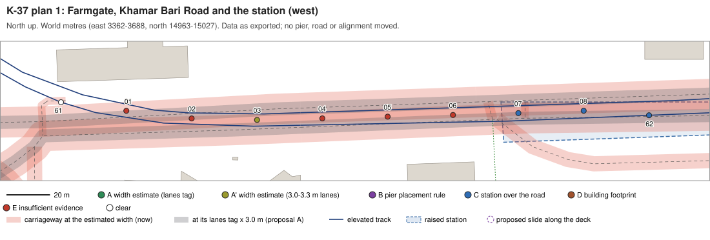 | 1: Khamar Bari Road and Farmgate station (west) | K37-01 to 08, 61, 62 |
| 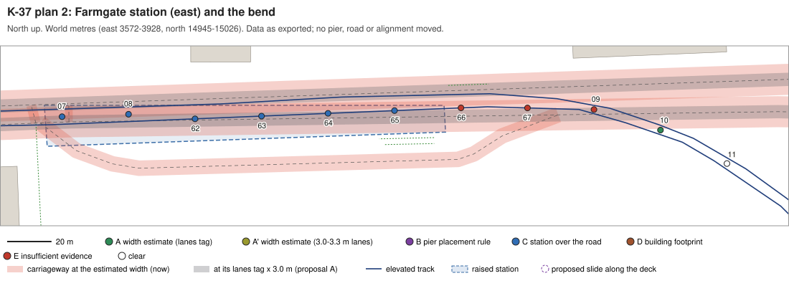 | 2: Farmgate station (east) and the bend | K37-07 to 11, 62 to 67 |
| 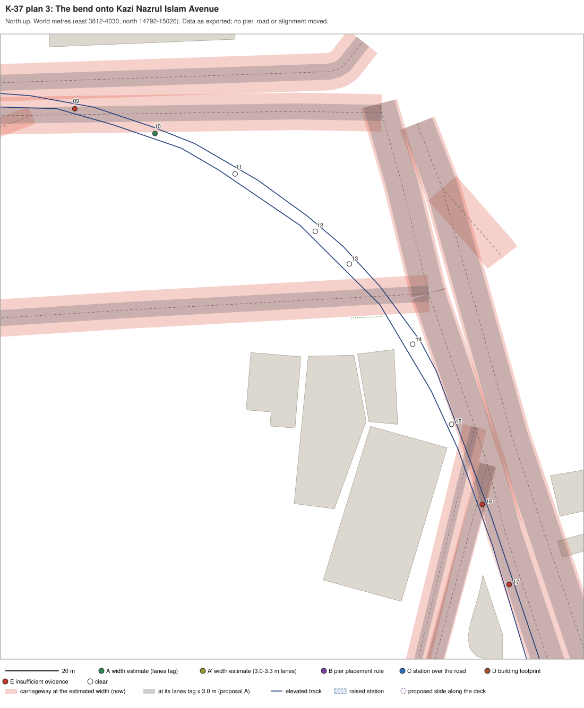 | 3: the bend onto the avenue | K37-09 to 17 |
| 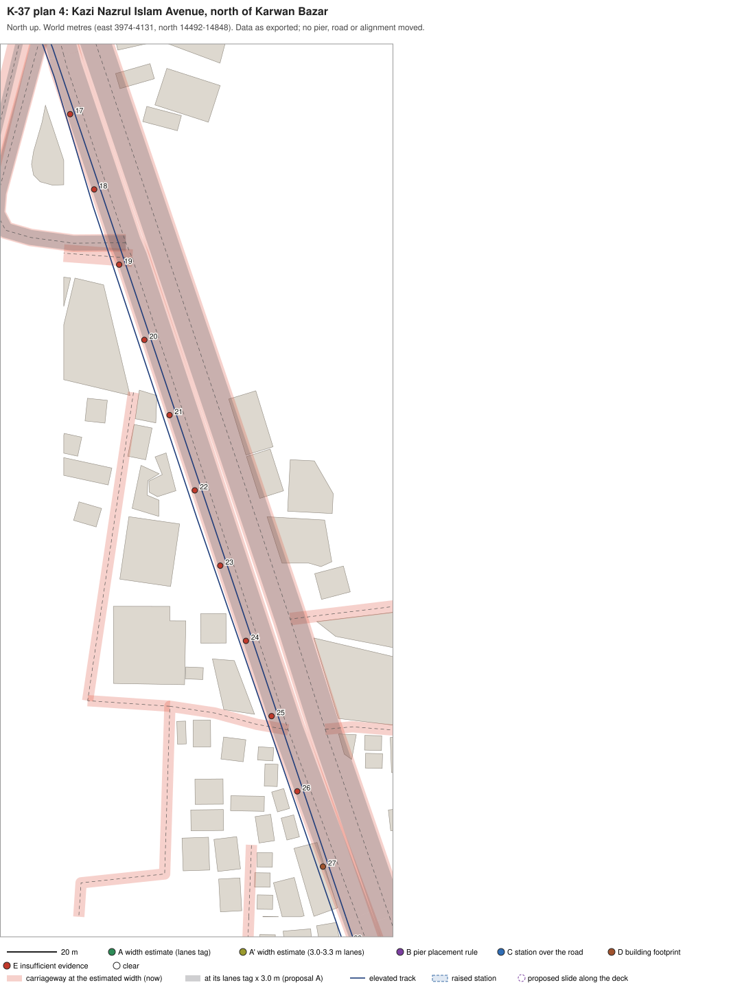 | 4: the avenue north of Karwan Bazar | K37-17 to 27 |
| 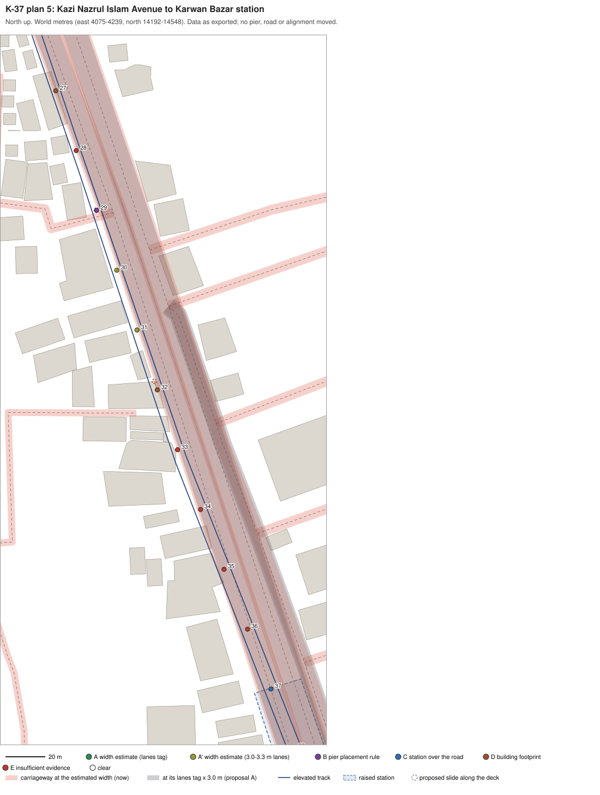 | 5: on to Karwan Bazar station | K37-27 to 37 |
| 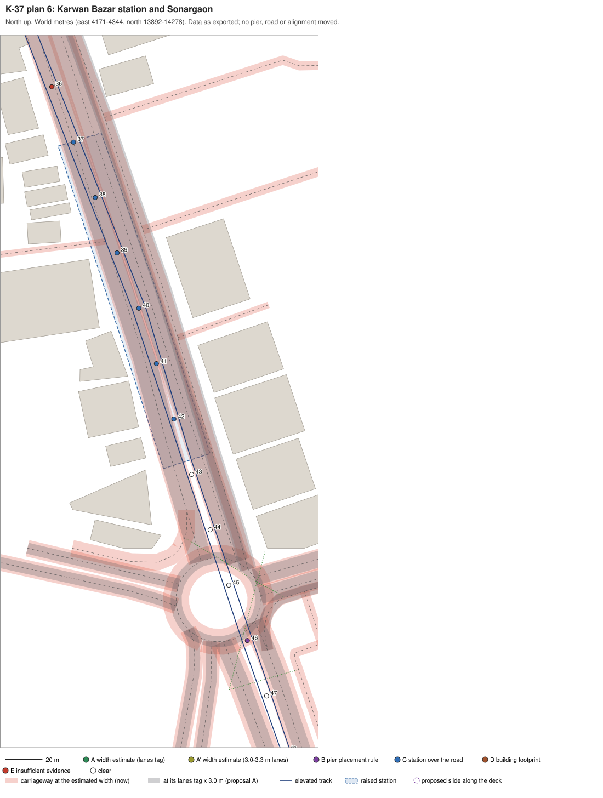 | 6: Karwan Bazar station and Sonargaon | K37-36 to 47 |
| 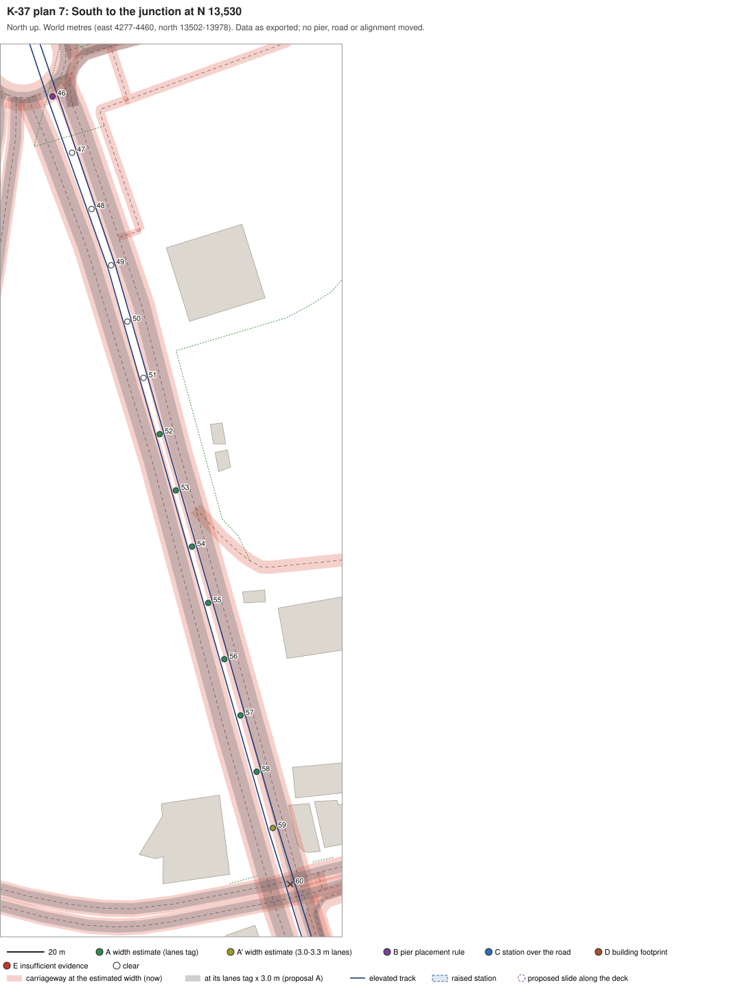 | 7: south to the junction | K37-46 to 60 |

Unity development player, 1280×720, noon, current state:

| Shot | View | Shows |
|---|---|---|
| 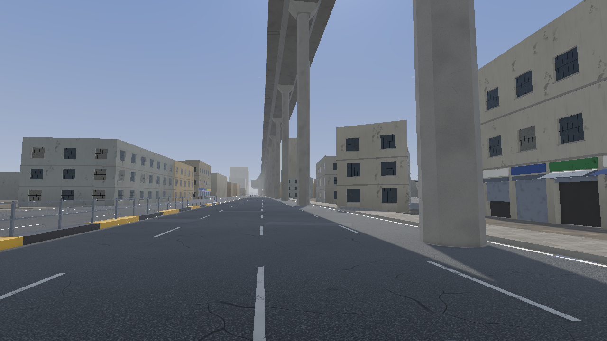 | `k37-kni-kerb`, looking south from 40 m north of K37-21 | Group E: piers inside the avenue's west lane |
| 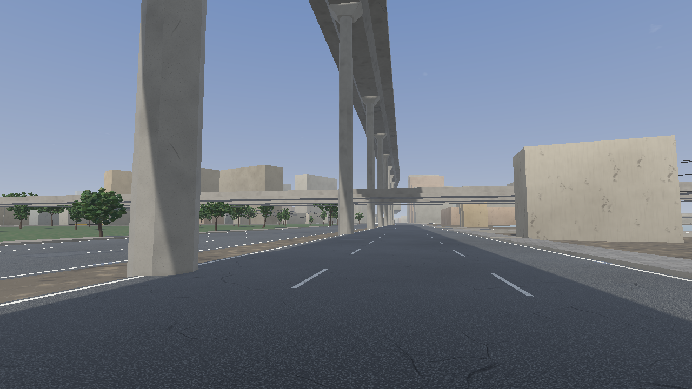 | `k37-kni-median`, looking north at K37-55 | Group A: piers at the median's edge, where the estimated widths overlap |
| 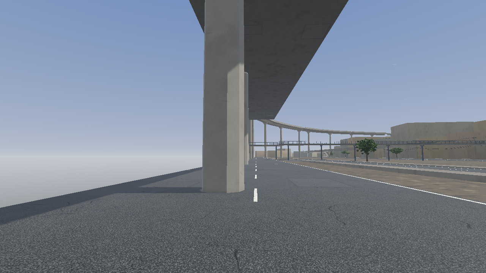 | `k37-farmgate-station`, looking east at K37-64 | Group C: a station pier on the lane line of Khamar Bari Road |
| 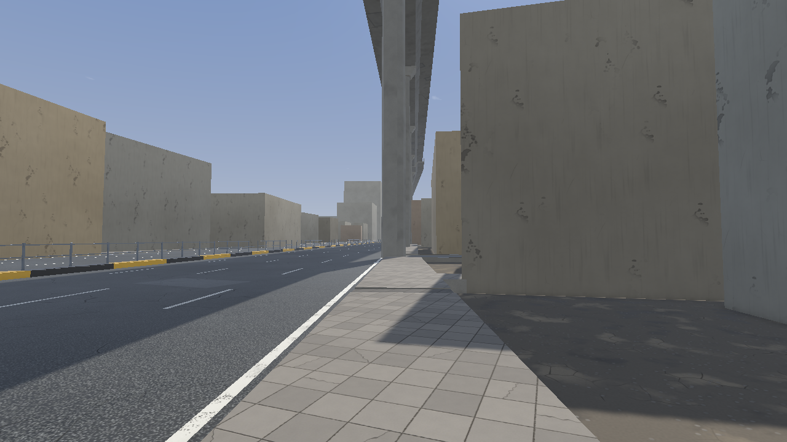 | `k37-side-street`, looking south at K37-29 | Group B: the pier at the kerb by a side street's mouth |
| 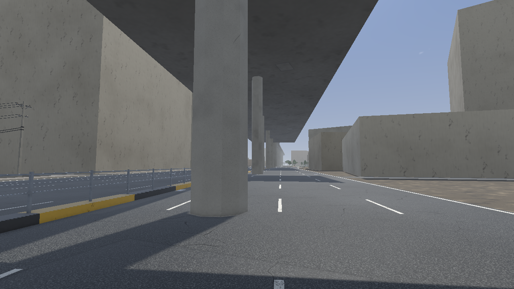 | `k37-karwan-station`, looking south at K37-39 | Group C: piers in the avenue under Karwan Bazar station |

## 8. Pier register

Width "est." is the exporter's class estimate. "Into narrowest carriageway" is how far the pier's face is inside the carriageway at its lanes tag × 3.0 m (the estimate where untagged). "Clears with" is the smallest correction found: a lane width, a slide along the deck, or a shift across it. All figures are in metres. Full data, including every road within 25 m, buildings within 10 m, spans and the neighbour's distance: [pier-register.csv](K37/pier-register.csv).

| Pier | Chunk | East, north (m) | Rail way, segment | Builder | Group | Road conflicts (way, class, width, lanes, centre-line distance, overlap) | Buildings | Into narrowest carriageway | Clears with |
|---|---|---|---|---|---|---|---|---|---|
| K37-01 | c_6_-30 | 3420.0, 14996.0 | 612562211 s0, 671984898 s2 | on a carriageway | E insufficient evidence | 1055297794 trunk 14 m est., 2 lanes, 2.9 m, **5.03 m** | none | 1.03 | slide -6 m (3.5 m lanes); shift across 1.25 m (3.0 m lanes) |
| K37-02 | c_6_-30 | 3450.0, 14992.4 | 612562211 s2, 671984898 s1 | on a carriageway | E insufficient evidence | 343016048 trunk 14 m est., 2 lanes, 5.9 m, **2 m**; 1055297794 trunk 14 m est., 2 lanes, 2.3 m, **5.62 m** | none | 1.62 | shift across -1.75 m (3.0 m lanes) |
| K37-03 | c_6_-30 | 3480.0, 14991.8 | 612562211 s2, 671984898 s0 | on a carriageway | A' width estimate (narrow lanes) | 343016048 trunk 14 m est., 2 lanes, 4.2 m, **3.72 m**; 1055297794 trunk 14 m est., 2 lanes, 4.6 m, **3.3 m** | none | - | lanes x 3.0 m |
| K37-04 | c_7_-30 | 3510.0, 14992.5 | 612562211 s0, 671984898 s11 | on a carriageway | E insufficient evidence | 343016048 trunk 14 m est., 2 lanes, 3.7 m, **4.22 m**; 1055297794 trunk 14 m est., 2 lanes, 5.1 m, **2.8 m** | none | 0.22 | slide -11.25 m (3.0 m lanes); shift across 0.25 m (3.0 m lanes) |
| K37-05 | c_7_-30 | 3540.0, 14993.3 | 612562211 s0, 671984898 s11 | on a carriageway | E insufficient evidence | 343016048 trunk 14 m est., 2 lanes, 3.2 m, **4.65 m**; 1055297794 trunk 14 m est., 2 lanes, 5.3 m, **2.56 m** | none | 0.65 | shift across 0.75 m (3.0 m lanes) |
| K37-06 | c_7_-30 | 3570.0, 14994.0 | 612562211 s0, 671984898 s11 | on a carriageway | E insufficient evidence | 343016048 trunk 14 m est., 2 lanes, 2.8 m, **5.09 m**; 1055297794 trunk 14 m est., 2 lanes, 5.6 m, **2.31 m** | none | 1.09 | shift across 1.25 m (3.0 m lanes) |
| K37-07 | c_7_-30 | 3600.0, 14994.9 | 612562211 s0, 671984898 s10 | on a carriageway | C station over road | 343016048 trunk 14 m est., 2 lanes, 2.5 m, **5.42 m** | station 1125768748 (5.1 m in) | 1.42 | shift across 1.5 m (3.0 m lanes) |
| K37-08 | c_7_-30 | 3630.0, 14996.0 | 612562211 s0, 671984898 s10 | on a carriageway | C station over road | 343016048 trunk 14 m est., 2 lanes, 3.1 m, **4.82 m** | station 1125768748 (4.0 m in) | 0.82 | shift across 1 m (3.0 m lanes) |
| K37-09 | c_7_-30 | 3840.0, 14998.1 | 612562211 s0, 671984898 s8 | on a carriageway | E insufficient evidence | 343016048 trunk 14 m est., 2 lanes, 2.2 m, **5.72 m** | none | 1.72 | slide -11.5 m (3.5 m lanes); shift across 2 m (3.0 m lanes) |
| K37-10 | c_7_-30 | 3870.0, 14988.8 | 612562211 s2, 671984898 s7 | on a carriageway | A width estimate | 343016048 trunk 14 m est., 2 lanes, 7.5 m, **0.37 m** | none | - | lanes x 3.5 m |
| K37-11 | c_7_-30 | 3900.0, 14973.7 | 612562211 s3, 671984898 s5 | clear | clear | none | none | - | - |
| K37-12 | c_7_-30 | 3930.0, 14952.2 | 612562211 s5, 671984898 s4 | clear | clear | none | none | - | - |
| K37-13 | c_7_-30 | 3942.8, 14940.0 | 612562211 s6, 671984898 s4 | clear | clear | none | none | - | - |
| K37-14 | c_7_-30 | 3966.4, 14910.0 | 612562211 s7, 671984898 s3 | clear | clear | none | none | - | - |
| K37-15 | c_7_-30 | 3981.0, 14880.0 | 612562211 s9, 671984898 s2 | clear | clear | none | none | - | - |
| K37-16 | c_7_-30 | 3992.5, 14850.0 | 612562211 s9, 671984898 s1 | on a carriageway | E insufficient evidence | 223100550 trunk_link 7 m est., 2 lanes, 2.0 m, **2.44 m**; 528310083 trunk 14 m est., 4 lanes, 5.6 m, **2.26 m** | none | 1.94 | slide -11.75 m (3.0 m lanes); shift across -7.25 m (3.0 m lanes) |
| K37-17 | c_8_-30 | 4002.6, 14820.0 | 612562211 s0, 671984898 s2 | on a carriageway | E insufficient evidence | 528310083 trunk 14 m est., 4 lanes, 4.7 m, **3.17 m** | none | 2.17 | shift across -2.25 m (3.0 m lanes) |
| K37-18 | c_8_-30 | 4012.1, 14790.0 | 612562211 s0, 671984898 s2 | on a carriageway | E insufficient evidence | 528310083 trunk 14 m est., 4 lanes, 5.2 m, **2.71 m** | none | 1.71 | shift across -1.75 m (3.0 m lanes) |
| K37-19 | c_8_-30 | 4022.1, 14760.0 | 612562211 s0, 671984898 s1 | on a carriageway | E insufficient evidence | 528310083 trunk 14 m est., 4 lanes, 5.8 m, **2.09 m**; 752111411 trunk_link 7 m est., no lanes tag, 3.0 m, **1.43 m** | none | 1.43 | shift across -3.75 m (3.0 m lanes) |
| K37-20 | c_8_-30 | 4032.2, 14730.0 | 612562211 s0, 671984898 s1 | on a carriageway | E insufficient evidence | 528310083 trunk 14 m est., 4 lanes, 5.7 m, **2.23 m** | none | 1.23 | shift across -1.25 m (3.0 m lanes) |
| K37-21 | c_8_-30 | 4042.2, 14700.0 | 612562211 s0, 671984898 s1 | on a carriageway | E insufficient evidence | 528310083 trunk 14 m est., 4 lanes, 5.5 m, **2.37 m** | none | 1.37 | shift across -1.5 m (3.0 m lanes) |
| K37-22 | c_8_-30 | 4052.3, 14670.0 | 612562211 s0, 671984898 s1 | on a carriageway | E insufficient evidence | 528310083 trunk 14 m est., 4 lanes, 5.4 m, **2.51 m** | none | 1.51 | shift across -1.75 m (3.0 m lanes) |
| K37-23 | c_8_-30 | 4062.4, 14640.0 | 612562211 s0, 671984898 s0 | on a carriageway | E insufficient evidence | 528310083 trunk 14 m est., 4 lanes, 5.1 m, **2.76 m** | none | 1.76 | shift across -2 m (3.0 m lanes) |
| K37-24 | c_8_-30 | 4072.7, 14610.0 | 612562211 s0, 671984898 s0 | on a carriageway | E insufficient evidence | 528310083 trunk 14 m est., 4 lanes, 4.8 m, **3.07 m** | none | 2.07 | shift across -2.25 m (3.0 m lanes) |
| K37-25 | c_8_-30 | 4082.9, 14580.0 | 612562211 s0, 671984898 s0 | on a carriageway | E insufficient evidence | 528310083 trunk 14 m est., 4 lanes, 4.5 m, **3.38 m** | none | 2.38 | shift across 11.5 m (3.0 m lanes) |
| K37-26 | c_8_-30 | 4093.2, 14550.0 | 612562211 s0, 671984898 s0 | on a carriageway | E insufficient evidence | 528310083 trunk 14 m est., 4 lanes, 5.1 m, **2.81 m** | none | 1.81 | shift across -2 m (3.0 m lanes) |
| K37-27 | c_8_-30 | 4103.4, 14520.0 | 612562211 s0, 671984898 s0 | on a carriageway | D building footprint | 528310083 trunk 14 m est., 4 lanes, 5.9 m, **1.98 m** | 297758302 construction (0.65 m in) | 0.98 | shift across -9.25 m (3.0 m lanes) |
| K37-28 | c_8_-29 | 4113.7, 14490.0 | 612562211 s1, 671984898 s3 | on a carriageway | E insufficient evidence | 528310083 trunk 14 m est., 4 lanes, 6.7 m, **1.18 m** | none | 0.18 | slide 8 m (3.0 m lanes); shift across -0.25 m (3.0 m lanes) |
| K37-29 | c_8_-29 | 4123.9, 14460.0 | 612562211 s1, 671984898 s2 | on a carriageway | B pier placement | 297117157 living_street 4.5 m est., no lanes tag, 3.1 m, **0.02 m**; 528310083 trunk 14 m est., 4 lanes, 7.6 m, **0.33 m** | none | 0.02 | slide -0.25 m (3.0 m lanes); shift across 0.25 m (3.0 m lanes) |
| K37-30 | c_8_-29 | 4134.1, 14430.0 | 612562211 s1, 671984898 s2 | on a carriageway | A' width estimate (narrow lanes) | 528310083 trunk 14 m est., 4 lanes, 7.5 m, **0.43 m** | none | - | lanes x 3.0 m |
| K37-31 | c_8_-29 | 4144.2, 14400.0 | 612562211 s1, 671984898 s2 | on a carriageway | A' width estimate (narrow lanes) | 528310083 trunk 14 m est., 4 lanes, 7.2 m, **0.66 m** | none | - | lanes x 3.0 m |
| K37-32 | c_8_-29 | 4154.4, 14370.0 | 612562211 s1, 671984898 s2 | on a carriageway | D building footprint | 528310083 trunk 14 m est., 4 lanes, 7.0 m, **0.89 m** | 297114200 commercial (1.01 m in) | - | slide -4.5 m (3.0 m lanes) |
| K37-33 | c_8_-29 | 4164.5, 14340.0 | 612562211 s1, 671984898 s2 | on a carriageway | E insufficient evidence | 528310083 trunk 14 m est., 4 lanes, 6.8 m, **1.12 m** | none | 0.12 | slide -9.75 m (3.0 m lanes); shift across -0.25 m (3.0 m lanes) |
| K37-34 | c_8_-29 | 4176.1, 14310.0 | 612562211 s2, 671984898 s1 | on a carriageway | E insufficient evidence | 528310083 trunk 14 m est., 4 lanes, 5.2 m, **2.67 m** | none | 1.67 | shift across -1.75 m (3.0 m lanes) |
| K37-35 | c_8_-29 | 4187.9, 14280.0 | 612562211 s2, 671984898 s1 | on a carriageway | E insufficient evidence | 528310083 trunk 14 m est., 4 lanes, 3.5 m, **4.45 m** | none | 3.45 | none found within 12 m |
| K37-36 | c_8_-29 | 4199.7, 14250.0 | 612562211 s2, 671984898 s1 | on a carriageway | E insufficient evidence | 528310083 trunk 14 m est., 4 lanes, 1.7 m, **6.23 m** | none | 5.23 | shift across -5.25 m (3.0 m lanes) |
| K37-37 | c_8_-29 | 4211.5, 14220.0 | 612562211 s2, 671984898 s1 | on a carriageway | C station over road | 528310083 trunk 14 m est., 4 lanes, 0.1 m, **7.79 m** | station 1125773740 (0.4 m in) | 6.79 | shift across -7.25 m (3.0 m lanes) |
| K37-38 | c_8_-29 | 4223.3, 14190.0 | 612562211 s2, 671984898 s1 | on a carriageway | C station over road | 528310083 trunk 14 m est., 4 lanes, 1.9 m, **6.01 m** | station 1125773740 (10.5 m in) | 5.01 | shift across -9 m (3.0 m lanes) |
| K37-39 | c_8_-29 | 4235.1, 14160.0 | 612562211 s2, 671984898 s1 | on a carriageway | C station over road | 528310083 trunk 14 m est., 4 lanes, 3.7 m, **4.2 m** | station 1125773740 (12.3 m in) | 3.2 | shift across -10.75 m (3.0 m lanes) |
| K37-40 | c_8_-29 | 4246.9, 14130.0 | 612562211 s2, 671984898 s0 | on a carriageway | C station over road | 528310083 trunk 14 m est., 4 lanes, 5.6 m, **2.29 m**; 528310084 trunk 14 m est., 4 lanes, 7.0 m, **0.95 m** | station 1125773740 (12.2 m in) | 1.29 | none found within 12 m |
| K37-41 | c_8_-29 | 4256.4, 14100.0 | 612562211 s3, 671984898 s0 | on a carriageway | C station over road | 528310083 trunk 14 m est., 4 lanes, 5.7 m, **2.24 m**; 528310084 trunk 14 m est., 4 lanes, 7.4 m, **0.49 m** | station 1125773740 (12.4 m in) | 1.24 | none found within 12 m |
| K37-42 | c_8_-29 | 4265.9, 14070.0 | 612562211 s3, 671984898 s0 | on a carriageway | C station over road | 528310083 trunk 14 m est., 4 lanes, 7.1 m, **0.78 m** | station 1125773740 (12.8 m in) | - | lanes x 3.0 m |
| K37-43 | c_8_-29 | 4275.4, 14040.0 | 612562211 s4, 671984898 s0 | clear | clear | none | none | - | - |
| K37-44 | c_8_-29 | 4285.5, 14010.0 | 612562211 s4, 671984898 s0 | clear | clear | none | none | - | - |
| K37-45 | c_8_-28 | 4295.6, 13980.0 | 612562211 s0, 671984898 s3 | clear | clear | none | none | - | - |
| K37-46 | c_8_-28 | 4305.6, 13950.0 | 612562211 s0, 671984898 s3 | on a carriageway | B pier placement | 155271803 trunk 14 m est., 3 lanes, 7.9 m, **0.03 m**; 565194019 trunk 14 m est., 2 lanes, 4.3 m, **3.58 m** | none | - | lanes x 3.0 m |
| K37-47 | c_8_-28 | 4316.1, 13920.0 | 612562211 s0, 671984898 s2 | clear | clear | none | none | - | - |
| K37-48 | c_8_-28 | 4326.5, 13890.0 | 612562211 s0, 671984898 s2 | clear | clear | none | none | - | - |
| K37-49 | c_8_-28 | 4336.9, 13860.0 | 612562211 s0, 671984898 s2 | clear | clear | none | none | - | - |
| K37-50 | c_8_-28 | 4345.6, 13830.0 | 612562211 s1, 671984898 s1 | clear | clear | none | none | - | - |
| K37-51 | c_8_-28 | 4354.2, 13800.0 | 612562211 s1, 671984898 s1 | clear | clear | none | none | - | - |
| K37-52 | c_8_-28 | 4362.8, 13770.0 | 612562211 s1, 671984898 s1 | on a carriageway | A width estimate | 155271803 trunk 14 m est., 3 lanes, 7.7 m, **0.2 m** | none | - | lanes x 3.5 m |
| K37-53 | c_8_-28 | 4371.4, 13740.0 | 612562211 s1, 671984898 s1 | on a carriageway | A width estimate | 155271803 trunk 14 m est., 3 lanes, 7.4 m, **0.47 m** | none | - | lanes x 3.5 m |
| K37-54 | c_8_-28 | 4380.1, 13710.0 | 612562211 s1, 671984898 s1 | on a carriageway | A width estimate | 155271803 trunk 14 m est., 3 lanes, 7.3 m, **0.58 m** | none | - | lanes x 3.5 m |
| K37-55 | c_8_-28 | 4388.7, 13680.0 | 612562211 s1, 671984898 s1 | on a carriageway | A width estimate | 155271803 trunk 14 m est., 3 lanes, 7.1 m, **0.82 m** | none | - | lanes x 3.5 m |
| K37-56 | c_8_-28 | 4397.3, 13650.0 | 612562211 s1, 671984898 s1 | on a carriageway | A width estimate | 155271803 trunk 14 m est., 3 lanes, 6.8 m, **1.05 m** | none | - | lanes x 3.5 m |
| K37-57 | c_8_-28 | 4405.9, 13620.0 | 612562211 s1, 671984898 s1 | on a carriageway | A width estimate | 155271803 trunk 14 m est., 3 lanes, 6.6 m, **1.29 m** | none | - | lanes x 3.5 m |
| K37-58 | c_8_-28 | 4414.6, 13590.0 | 612562211 s1, 671984898 s1 | on a carriageway | A width estimate | 155271803 trunk 14 m est., 3 lanes, 6.4 m, **1.53 m** | none | - | lanes x 3.5 m |
| K37-59 | c_8_-28 | 4423.2, 13560.0 | 612562211 s1, 671984898 s0 | on a carriageway | A' width estimate (narrow lanes) | 155271803 trunk 14 m est., 3 lanes, 6.1 m, **1.78 m** | none | - | lanes x 3.0 m |
| K37-60 | c_8_-28 | 4432.5, 13530.0 | 612562211 s2, 671984898 s0 | in a junction: spanned | junction, spanned | 155271803 trunk 14 m est., 3 lanes, 5.6 m, **2.32 m**; 223077997 secondary 9 m est., 2 lanes, 2.1 m, **3.32 m**; 343245804 primary 11 m est., 2 lanes, 5.6 m, **0.82 m**; 691209729 trunk 14 m est., 3 lanes, 5.2 m, **2.65 m** | none | 1.82 | not built (junction spanned) |
| K37-61 | c_6_-30 | 3390.0, 14999.9 | 671984898 s3 | clear | clear | none | none | - | - |
| K37-62 | c_7_-30 | 3660.0, 14993.9 | 671984898 s10, 612562211 s0 | on a carriageway | C station over road | 343016048 trunk 14 m est., 2 lanes, 0.6 m, **7.33 m** | station 1125768748 (6.1 m in) | 3.33 | shift across -3.5 m (3.0 m lanes) |
| K37-63 | c_7_-30 | 3690.0, 14995.1 | 671984898 s10 | on a carriageway | C station over road | 343016048 trunk 14 m est., 2 lanes, 1.4 m, **6.53 m** | station 1125768748 (4.9 m in) | 2.53 | shift across -2.75 m (3.0 m lanes) |
| K37-64 | c_7_-30 | 3720.0, 14996.4 | 671984898 s10 | on a carriageway | C station over road | 343016048 trunk 14 m est., 2 lanes, 2.2 m, **5.73 m** | station 1125768748 (3.6 m in) | 1.73 | shift across -1.75 m (3.0 m lanes) |
| K37-65 | c_7_-30 | 3750.0, 14997.6 | 671984898 s10 | on a carriageway | C station over road | 343016048 trunk 14 m est., 2 lanes, 3.0 m, **4.92 m** | station 1125768748 (2.4 m in) | 0.92 | shift across -1 m (3.0 m lanes) |
| K37-66 | c_7_-30 | 3780.0, 14998.9 | 671984898 s10 | on a carriageway | E insufficient evidence | 343016048 trunk 14 m est., 2 lanes, 3.8 m, **4.12 m** | none | 0.12 | slide -4.75 m (3.0 m lanes); shift across -0.25 m (3.0 m lanes) |
| K37-67 | c_7_-30 | 3810.0, 14998.8 | 671984898 s9 | on a carriageway | E insufficient evidence | 343016048 trunk 14 m est., 2 lanes, 3.3 m, **4.59 m** | none | 0.59 | shift across -0.75 m (3.0 m lanes) |

## 9. P-1 applied (2026-11-03)

The owner approved P-1 at 3.5 m lanes. Built as a read-time rule in `Runtime/World/RoadWidths.cs`, called by `Dadc.Load` and by the road and building builders. The DADC files, `Dadc.Decode` and the exporter are unchanged.

**The rule.** A road whose width is estimated, which is one-way in the routing graph and has a lanes tag, takes lanes × 3.5 m **when that is narrower** than its class width. Every other road keeps the exporter's width.

**Why narrowing only.** As first built, the rule also widened 123 ways city-wide. In the slice, that put Manik Mia Avenue's three 7-lane carriageways (ways 167533249, 506695204, 1341259201) at 24.5 m instead of 14 m. At that width they covered the avenue's mapped median tree row, which stands 10–12 m from their centre lines: 24 trees became "on a carriageway". A mapped lamp 4.9 m from a centre line would have been pushed 7.8 m out. The mapped trees are evidence that 24.5 m is too wide, so the owner chose narrowing only.

**Only the carriageway changes.** Whether a road has sidewalks (6 m rule) and is marked as a major road (6.5 m rule) is still judged by its class width, kept in `Road.ClassWidthCm`. So P-1 moves kerbs but adds or removes no sidewalk or line markings. Without this, narrowing would have removed sidewalks from one-lane one-way streets.

**Result** (re-run of `Tools/k37/run.sh`, files in [K37/after-p1](K37/after-p1/README.md)):

| | Before P-1 | After P-1 |
|---|---|---|
| Piers on a carriageway (builder) | 52 | 44 |
| Group A (K37-10, K37-52 to K37-58) | 8 in conflict | clear |
| A′ / B / C / D / E | 4 / 2 / 12 / 2 / 24 | unchanged |
| Clear | 14 | 22 |
| Ways narrowed city-wide | — | 726 (primary 331, secondary 193, trunk 107, others 95) |
| Ways the lanes tag would widen, left at the class width | — | 123 |

**Slice, before and after** (Mono harness, same tests):

| | Before | After |
|---|---|---|
| Sidewalk points covered | 8,749 of 8,756 | 9,971 of 9,979 |
| Drain points open | 17,652 of 17,686 | 17,783 of 17,819 |
| Lamps placed (moved to the kerb) | 58 of 64 (18) | 61 of 64 (4) |
| Trees placed | 189 of 199 | 193 of 199 |
| Utility poles | 1,060 | 1,142 |
| Divider pieces | 608 (2.4 km) | 197 (0.8 km) |

Dividers are built only where twin carriageways' drawn surfaces meet or overlap (K-31). Narrowed twins now leave an open median between them, 5.1–6.5 m on the avenue as section 3 (V-3) predicted. It is drawn as open ground, as the builder already did for wider medians. A kerbed or planted median is not built; that belongs with the D-11 islands and dividers work.

**What it looks like.** 11 of the 29 golden views changed and were accepted after a side-by-side look; 18 matched exactly. Every change is narrower carriageways: open-ground medians where twin carriageways used to overlap, and fewer dividers. Piers, deck, buildings and stations are pixel-for-pixel where they were. After-shots of two K-37 views are in [K37/after-p1/shots](K37/after-p1/shots):

| Before (section 7) | After P-1 |
|---|---|
|  | 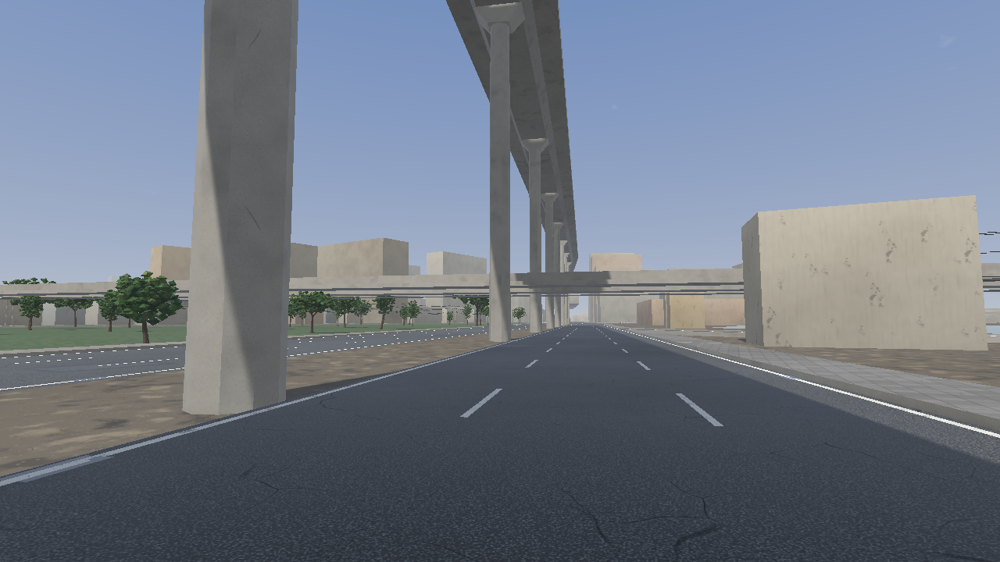 |
| `k37-kni-median`, K37-55: the pier stood at the edge of overlapping carriageways | it now stands on the open median, clear of both |
|  | 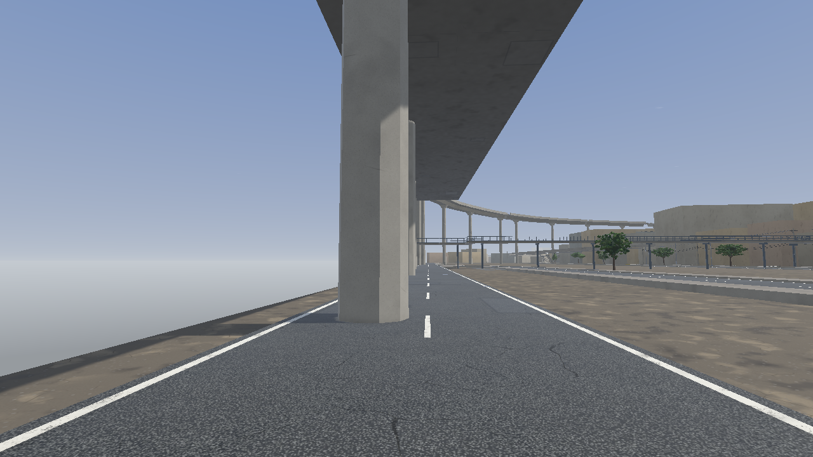 |
| `k37-farmgate-station`, K37-64 (group C) | Khamar Bari Road is 7 m, not 14 m; the station pier is still in group C |

**Test changes, each with its reason:**
- Sidewalk coverage: a band whose outer edge would leave the chunk is not built (K-33, an existing builder rule). Narrower roads bring 75 such points inside the chunk, mostly along the north border on Khamar Bari Road. They are now counted as their own category, not as misses. The other misses are 7 before and 7 after.
- Markings spot check: the test now lays out its expected lines on the segment's drawn half width, as the builder does, instead of the road's nominal width. They differ where a road end is narrowed at the chunk border.
- Dividers: a divider may stand on a face up to 0.05 m below its base height, which is how far its base reaches. A broken slab on a median band is 0.04 m lower.
- Lamps: the builder now moves a mapped lamp at most `LampMove` (6 m) to the kerb, else lists it. That matches the limit the test already stated; a new test checks it.
- Farmgate pads: c_7_-30 has 5 junction pads, not 6. Khamar Bari Road's two pieces (343016048, now 7 m, and 698209679, 14 m) no longer chain across way 142049043, because chaining needs similar widths. Each is now a T-junction stem pulled back to the through road's edge, the builder's existing treatment, so that crossing needs no pad. The test's floor is now 5, with this reason in a comment.
- Street cell bounds (a latent bug the new widths exposed, fixed in the code): the streamer gave each 125 m street cell fixed bounds, the cell's square plus 20 m. But a cable span belongs to the cell of its first pole, and one now reaches 21.4 m past its cell (c_7_-30, cell 7). `ChunkStreamerTests` caught the vertex outside the bounds. Such a mesh can be culled while part of it is on screen. The builder now records each range's own extent (`ChunkStreet.RangeMin`/`RangeMax`, as it already did for structures), and the streamer bounds each cell mesh by that.
- New `RoadWidthTests` (4 tests). All 9 mutations were caught: rule off, 3.0 m lanes, two-way roads included, widening allowed, mapped widths included, sidewalks or lines judged by the new width, no read-time call in `Dadc.Load`, none in the road builder, and the lamp cap removed.

No pier, deck, rail alignment, road centre line or building moved, and no world data changed. P-2 (pier rule fixes) is not applied.

## 10. P-2 applied (2026-11-04)

The owner approved P-2 together with K-50 (a) and (b) on 2026-11-04. The full record, with the before and after register and the Line 6 figures, is [P2_PIER_RULES.md](P2_PIER_RULES.md). In the slice:

| Pier | Before P-2 | After P-2 |
|---|---|---|
| K37-61 (E 3,390, V-5) | built in both c_6_-30 and c_6_-31, 3.6 m apart | one pier, built by c_6_-31 |
| K37-62 to K37-67 (Farmgate, K-50 a) | two single-track decks, a pier under each: 6 places with 2 piers 5.2–7.0 m apart | one twin deck on the centre line between the tracks, one pier per place: 3 in c_7_-30 (1 on a carriageway, 2 inside the raised station), 3 in c_7_-31 |
| K37-13 (bend, V-6) | 17.7 m from K37-12 | not built (span under 25 m); K37-12 to K37-14 is one 55.8 m span |
| K37-16 (V-4, crossing trunk_link 223100550) | on a carriageway | spanned: no place within 4 m along the deck is clear |
| K37-29 (V-4, living street 297117157) | 0.02 m into the side street | slid 0.25 m along the deck: clear of the side street; still 0.34 m into the avenue's trunk 528310083 (0.33 m before), the group B finding that remains |
| K37-46 (V-4, Sonargaon roundabout 565194019) | 1.84 m into the ring after P-1 (3.58 m before it), and in a crossing keep-out | slid 3.75 m along the deck: 0.11 m clear of the ring and out of the keep-out |
| N 13,500 grid line (K-50 b) | no pier from either chunk: 94.2 m from K37-59 to the next pier | a pier (VP-4441.8-13500.0), 1.10 m into the along-road trunk 691209729 at its estimated width (as group A); K37-59 to it is 62.8 m along the skewed deck, 60 m on the main axis, with K37-60 still spanned over its junction |

Slice totals: 61 piers built (66 before), 38 on a carriageway (44 before). No pier moved across the deck, no track, road, building or chunk file changed.

## 11. P-6 applied (2026-11-04)

The owner's decision 3 ([WORLD_TRANSFORMATION_PLAN.md](WORLD_TRANSFORMATION_PLAN.md), section 3a): a raised median island under a pier on a carriageway where the road is wide enough, with traffic passing on both sides; otherwise the pier stays listed. The full record is [P6_MEDIAN_ISLANDS.md](P6_MEDIAN_ISLANDS.md). Every slice pier that was on a carriageway after P-2, with what P-6 did:

| Pier | Support | Carriageway | P-6 | Survey after P-6 |
|---|---|---|---|---|
| K37-01 | VP-3420.0-14996.0 | 1055297794 | one side | carriageway: 1.53 m into trunk 1055297794 (estimated width) |
| K37-02 | VP-3450.0-14992.4 | 1055297794 | one side | carriageway: 2.12 m into trunk 1055297794 (estimated width) |
| K37-03 | VP-3480.0-14991.8 | 343016048 | island | note median: on a median island on 1055297794: 6.33 m and 0.00 m of carriageway left beside it |
| K37-04 | VP-3510.0-14992.5 | 343016048 | island | note median: on a median island on 343016048: 0.00 m and 5.65 m of carriageway left beside it |
| K37-05 | VP-3540.0-14993.3 | 343016048 | island | note median: on a median island on 343016048: 0.00 m and 5.22 m of carriageway left beside it |
| K37-06 | VP-3570.0-14994.0 | 343016048 | island | note median: on a median island on 343016048: 0.00 m and 4.78 m of carriageway left beside it |
| K37-07 | VP-3600.0-14994.9 | 343016048 | crossing road | carriageway: 1.92 m into trunk 343016048 (estimated width) |
| K37-08 | VP-3630.0-14996.0 | 343016048 | one side | carriageway: 1.32 m into trunk 343016048 (estimated width) |
| K37-62 | VP-3660.0-14997.1 | 343016048 | one side | carriageway: 0.65 m into trunk 343016048 (estimated width) |
| K37-09 | VP-3840.0-14998.1 | 343016048 | border | carriageway: 2.22 m into trunk 343016048 (estimated width) |
| K37-17 | VP-4002.6-14820.0 | 528310083 | border | carriageway: 3.17 m into trunk 528310083 (estimated width) |
| K37-18 | VP-4012.1-14790.0 | 528310083 | narrow | carriageway: 2.71 m into trunk 528310083 (estimated width) |
| K37-19 | VP-4022.1-14760.0 | 528310083 | crossing road | carriageway: 1.48 m into trunk 528310083 (estimated width) |
| K37-20 | VP-4032.2-14730.0 | 528310083 | one side | carriageway: 2.23 m into trunk 528310083 (estimated width) |
| K37-21 | VP-4042.2-14700.0 | 528310083 | one side | carriageway: 2.37 m into trunk 528310083 (estimated width) |
| K37-22 | VP-4052.3-14670.0 | 528310083 | one side | carriageway: 2.51 m into trunk 528310083 (estimated width) |
| K37-23 | VP-4062.4-14640.0 | 528310083 | narrow | carriageway: 2.76 m into trunk 528310083 (estimated width) |
| K37-24 | VP-4072.7-14610.0 | 528310083 | narrow | carriageway: 3.07 m into trunk 528310083 (estimated width) |
| K37-25 | VP-4082.9-14580.0 | 528310083 | crossing road | carriageway: 3.37 m into trunk 528310083 (estimated width) |
| K37-26 | VP-4093.2-14550.0 | 528310083 | narrow | carriageway: 2.81 m into trunk 528310083 (estimated width) |
| K37-27 | VP-4103.4-14520.0 | 528310083 | building | carriageway: 1.98 m into trunk 528310083 (estimated width) |
| K37-28 | VP-4113.7-14490.0 | 528310083 | one side | carriageway: 1.18 m into trunk 528310083 (estimated width) |
| K37-29 | VP-4123.8-14460.2 | 528310083 | crossing road | carriageway: 0.34 m into trunk 528310083 (estimated width) |
| K37-30 | VP-4134.1-14430.0 | 528310083 | one side | carriageway: 0.43 m into trunk 528310083 (estimated width) |
| K37-31 | VP-4144.2-14400.0 | 528310083 | one side | carriageway: 0.66 m into trunk 528310083 (estimated width) |
| K37-32 | VP-4154.4-14370.0 | 528310083 | building | carriageway: 0.89 m into trunk 528310083 (estimated width) |
| K37-33 | VP-4164.5-14340.0 | 528310083 | building | carriageway: 1.12 m into trunk 528310083 (estimated width) |
| K37-34 | VP-4176.1-14310.0 | 528310083 | one side | carriageway: 2.67 m into trunk 528310083 (estimated width) |
| K37-35 | VP-4187.9-14280.0 | 528310083 | narrow | carriageway: 4.45 m into trunk 528310083 (estimated width) |
| K37-36 | VP-4199.7-14250.0 | 528310083 | island | note median: on a median island on 528310083: 3.60 m and 6.95 m of carriageway left beside it |
| K37-37 | VP-4211.5-14220.0 | 528310083 | island | note median: on a median island on 528310083: 5.38 m and 5.17 m of carriageway left beside it |
| K37-38 | VP-4223.3-14190.0 | 528310083 | island | note median: on a median island on 528310083: 7.16 m and 3.39 m of carriageway left beside it |
| K37-39 | VP-4235.1-14160.0 | 528310083 | narrow | carriageway: 4.20 m into trunk 528310083 (estimated width) |
| K37-40 | VP-4246.9-14130.0 | 528310083 | island | note median: on a median island on 528310083: 10.87 m and 0.00 m of carriageway left beside it |
| K37-41 | VP-4256.4-14100.0 | 528310083 | island | note median: on a median island on 528310083: 11.03 m and 0.00 m of carriageway left beside it |
| K37-42 | VP-4265.8-14070.0 | 528310083 | island | note median: on a median island on 528310083: 12.50 m and 0.00 m of carriageway left beside it |
| K37-59 | VP-4423.2-13560.0 | 155271803 | one side | carriageway: 0.03 m into trunk 155271803 (estimated width) |
| (new) | VP-4441.8-13500.0 | 691209729 | border | carriageway: 1.10 m into trunk 691209729 (estimated width) |

"one side": an island would leave a lane of 3 m on one side only (it would stand against the kerb). "narrow": a lane under 3 m on a side. "crossing road": a road crosses under the island (more than 30° off the deck). "border": the island would cross the chunk border. "building": the island's footprint would reach into a building on the ground. Where an island shows 0.00 m on one side of its own carriageway, the other side's lane is the twin carriageway along the deck, within 1 m of the island's edge.

Slice totals: 61 piers built, as after P-2. **10 on islands, 28 on a carriageway (38 before).** On Line 6 (64 chunks): 23 on islands, 331 on a carriageway (354 before). No pier moved; no track, road, building or chunk file changed.

## 12. P-3 applied (2026-11-05)

The owner's "K-37 P-3 to P-5" (2026-11-05). P-3 is the counter wording of V-8 (the proposal table calls it V-9; V-8 is meant). Reporting only: no pier, road, track, building or chunk file changed, and nothing is drawn differently.

- **The builder** (`Structures.cs`, `Pier`) counts a pier whose centre is inside a building in one of two counters. `PiersInBuilding`: the building stands on the ground (base under 0.5 m), a conflict, reason `in a building`. `PiersUnderRaised`: the building is raised (a station body, or a building with a mapped base), the pier rises into it as a real station's piers do, reason `under a raised building`. A carriageway reason, where there is one, still takes the place of either.
- **Figures:** the slice's 13 piers "in a building" (12 at the investigation; P-2 removed the Farmgate duplicate, K37-61) are **2 in a building on the ground** (K37-27 and K37-32, group D) and **11 under a raised building** (group C). On Line 6 (64 chunks): **4 and 97** (101 before).
- **The checker** prints both against its own figures. Slice: 2 into a ground building; 11 rising through a raised one; 0 standing clear under one. Line 6: 4; 47; 58. The checker tests the pier's disc (0.9 m) and the building's base against the pier's top; the builder tests the centre point only, so Line 6 has 105 against 97.
- **Tests:** `ViaductIslandTests.APierInABuildingOnTheGroundIsCountedApartFromOneUnderARaisedBuilding` (made-up chunks, including a raised building in the notch of an L-shaped ground building); the slice split (2 and 11) is pinned in `StreetTests.ViaductCarriesEveryElevatedTrackOnPiers`, whose log line now gives both.
- **Mutations:** 8 of 8 caught, with a control that changes nothing (missed, as it should be): [INFRA/mutations-p3.txt](INFRA/mutations-p3.txt), harness `INFRA/mut_p3.py.txt` and `INFRA/P3Check.cs.txt`. The bounding-box-only mutant (B3) is caught only by the L-shaped case; today's data has no such pier.
- **The slice gate:** 68 violations, 0 new, 0 gone; the known list is unchanged. The register's builder note changes for 2 slice piers (VP-3690.0-14998.4 and VP-3720.0-14999.9, Farmgate station); the other 9 raised piers keep their carriageway reason.

P-4 and P-5 are not started: they wait for decision 3 (how real pier positions are sourced).

## 13. Evidence sources proposed for P-4 and P-5 (decision 3, 2026-11-05)

The owner asked for a proposed source ("Propose a source"). Nothing has been downloaded or saved; the sources below were found by web search only, and none has been opened yet.

**Already checked, locally:** the project's own OpenStreetMap extract (`dhaka-after-dark/data/raw/bangladesh.osm.pbf`) has 12 nodes tagged `bridge:support=pier` in the Line 6 area. None is within 95 m of a Line 6 viaduct pier. They are on flyovers, 12–75 m from our flyover supports. **The map data has no Line 6 pier positions.**

| Need | Proposed source | What it can settle | Licence and limits | Needs the owner's approval for |
|---|---|---|---|---|
| P-4: how the stations stand (portal frames or other) | Openly licensed photos of Farmgate and Karwan Bazar stations on Wikimedia Commons (the Farmgate category; the station article's photo) | The column arrangement under the station body | Per file, usually CC BY-SA; looked at in the browser pane, nothing saved; the licence of each file is checked before it is cited | Viewing Wikimedia Commons in the browser pane |
| P-4: design intent | JICA's public reports on MRT Line 6 (openjicareport.jica.go.jp; the contents list a section "Elevated Section Structures" and a design standard) | Typical viaduct and station sections, span length | Public report; a PDF, so reading it is a download (size to be stated before) | Downloading one named PDF |
| P-5: where the 26 piers stand | Mapillary street-level imagery along Kazi Nazrul Islam Avenue, looked at in the browser pane, no account | Each pier's place relative to the kerb, the median and landmarks, recorded in the register with the image key as reference | Images CC BY-SA; the right to derive data from them is reported only second-hand (for OSM and Commons) and must be confirmed on Mapillary's own page first; coverage unknown until looked at | Viewing Mapillary in the browser pane |
| P-5, where Mapillary has no coverage or is unclear | The owner's own photos at the named piers (register, section 8) | As above | The owner's | — |

**Not proposed:** Google Maps and Street View (their terms do not allow deriving data from the imagery); Bing or Esri aerial imagery (tracing licences are limited, and the piers are under the deck); news or agency photos (copyrighted).

**Recommended order:** Commons photos for P-4's arrangement, then Mapillary for P-5's positions, then the owner's photos for the piers still unclear. The JICA report only if the photos leave the station arrangement unclear. Each pier's evidence goes into the register with its source; any change still goes to the owner for approval before it is built.

## 14. Sources viewed (2026-11-05)

The owner approved viewing Wikimedia Commons and Mapillary in the browser pane ("Yes, view both"). Everything was looked at in the browser pane only: nothing was downloaded or saved, no account was used, and no image is in the project. What follows is what the photos show by eye; nothing was measured from them.

**Wikimedia Commons (for P-4).** Category "Farmgate metro station" has 19 files; "Karwan Bazar metro station" has 6. The ones viewed:

| File | Date, author, licence | What it shows |
|---|---|---|
| Farmgate metro station.jpg | 23 Nov 2023, LittleT889, CC0 | The station body from above: a long frame building on rows of columns at its edges, at regular bays. The viaduct leaves it on single central piers |
| Kawran Bazar metro station.jpg | 10 Sep 2023, মোহাম্মদ জনি হোসেন, CC BY-SA 4.0 | The viaduct reaching the station on a single central pier beside the station body; the body has its own heavy corner columns |
| Kawran Bazar metro station 1.jpg | 14 Apr 2024, Md Joni Hossain, CC BY-SA 4.0 | A road under the station's concourse, with large round columns on both sides of the carriageway |
| ট্রাফিক (০১).jpg | 14 Jan 2023, Ronju65, CC BY 4.0 | Kawran Bazar: tall round columns in a row beside the carriageway, behind a kerbed divider |
| Farmgate Metro Rail Station 01.jpg; Metro Rail ine ,Khamar Bari.jpg and 01; Farmgate Elivated Expressway & Metro Station.jpg | 2023, CC BY-SA 4.0 | The deck and the station from the street; the piers are hidden by traffic, trees or the angle |

**What this settles for P-4:** at both stations the station body stands on its own columns at its edges, and the viaduct's single central piers stop at the station ends. That supports the proposal's portal-frame idea in principle (columns outside the carriageway, the deck carried across). **It does not settle where each column stands** relative to the drawn carriageway: no photo can be measured, and none is taken square to the road. P-4 still needs positions (Mapillary or the owner's photos) before anything is built.

**Mapillary (for P-5).**
- **Terms** (mapillary.com/terms, effective 15 February 2024, read in full on the site): other users' images are CC BY-SA. Commercial use is allowed for "improvement, training, and development of products, services, maps", with two duties: no re-identification or unblurring, and processes against releasing the imagery. Section 13 separately allows use for OpenStreetMap. Recording pier positions read off the images, with each image's key as the reference and no image kept, fits these terms as I read them. That is not legal advice; the owner decides.
- **Coverage:** dense. Many sequences run along Kazi Nazrul Islam Avenue from Farmgate to Kawran Bazar and along Khamar Bari Road (the Farmgate piers K37-01 to K37-09 and K37-62 to K37-67).
- **One sample:** an image by "mozammel", 25 December 2022, at 23.75518 N, 90.39129 E, near K37-24 and K37-25, looking south down the avenue. It shows a row of viaduct piers along the right-hand edge of that carriageway, behind a line of concrete barriers (construction time), with traffic in the lanes to their left. That is consistent with the investigation's finding that north of Kawran Bazar the tracks run along the southbound carriageway's west edge. It is one image from the construction period, so it is not yet evidence for any single pier.
- **Limits:** the images are dashcam and phone views; a pier's place can be read as "in the median", "behind the barrier", "on the footway" or "in lane n", not to the centimetre. Later images (2024 on) are needed to see the finished road layout. While the browser pane is hidden the map does not respond to clicks.

**Proposed next step (P-5 evidence pass):** for each of the 38 piers in groups C, D and E, find the most recent Mapillary image that shows it and record in the register its place (median / barrier line / lane / footway / building), the image key, author and date. No geometry changes; the owner then decides each group with that evidence. Piers with no clear image go on a list for the owner's photos.

## 15. P-4 and P-5 evidence pass (2026-11-05)

The owner's go-ahead ("Yes, start the pass"). Mapillary imagery from 1 June 2024 on, looked at in the browser pane only: nothing downloaded or saved, no account, no API. All images below are by one contributor, **sawanshariar**, captured on **9 November 2024**, except 932283592179674, captured on **7 December 2024** (corrected 2026-11-05: each key's date was rechecked on its Mapillary page while planning P-5a; this section first gave 9 November for all), with a 360° camera (CC BY-SA 4.0 under Mapillary's terms). Each image is cited by its Mapillary key; its position is the one Mapillary gives, converted to world metres with the project's UTM 46N frame.

**Accuracy.** Mapillary positions are phone GNSS in a street canyon. The cameras plot 7–22 m east of our pier line on the avenue, where the piers are visibly a few metres to the camera's right, so the error is of that order. **Nothing here places a pier to better than about 10 m across the road.** What the images settle is the arrangement: what a pier stands on and what is beside it. No pier was matched one-to-one with ours, and real pier spacing was not measured.

| Piers (group) | Image key | Camera, E / N (m) | What the image shows |
|---|---|---|---|
| K37-01, -02, -04, -05, -06 (E), Khamar Bari Road west of the station | 2074291756362458 | 3487.4 / 14986.5 | The viaduct over a raised median with a striped kerb and a railing between Khamar Bari Road's two carriageways; a pier in it; the camera's carriageway has 2 lanes to the median |
| K37-07, -08, -62 to -65 (C), Farmgate station | 2213249369053417 | 3698.6 / 15003.9 | The carriageway runs under the station body: a continuous wall of columns on the median side behind a kerb, columns at the far kerb; no column in a lane |
| K37-09, -66, -67 (E), east of the station | 807792004729802 | 3802.6 / 15000.2 | A pier in the kerbed, railed median; ahead, the viaduct crosses the Farmgate junction on a **portal frame** (two columns and a cross-beam) |
| K37-16 to -19 (E), the avenue south of Farmgate | 8903848899679845, 1501202597262586, 975482414393047, 1889996618157587, 589928896715243 | 4022.1 / 14808.5 to 4038.9 / 14760.6 | The southbound carriageway (3 lanes) with the viaduct to its right, over a raised median with a striped kerb, barriers and a railing; every pier in view stands in that median; the northbound carriageway beyond it |
| K37-20 to -24 (E) | 932283592179674 | 4050.6 / 14695.2 | The same: piers in the median, 3 lanes beside it, footway and shops on the left |
| K37-25, -26, -28 (E); K37-27 (D) | 918393913041805 | 4109.3 / 14567.6 | The same; the viaduct deck overhangs the median edge; buildings stand behind the footway on the east side |
| K37-32 (D); K37-33 to -36 (E) | 1082726743511625 | 4156.4 / 14406.4 | The same: piers in the railed median, 2–3 lanes beside it |
| K37-37 to -42 (C), Kawran Bazar station | 578348621235211 | 4229.4 / 14197.0 | The carriageway runs under the station structure between two rows of square columns: one row at the footway kerb, one in the raised, railed median; no column in a lane |

Also seen: an image from 25 December 2022 (section 14) shows the same arrangement during construction, behind barriers.

**Findings.**
1. **Group E (24 piers) and group D (2 piers):** in every stretch sampled, the real piers stand in a raised, kerbed median between the two carriageways, and traffic passes beside them. None is in a lane. The piers in our build stand on the drawn carriageway because the carriageways are drawn too wide or with no median between them (K-31: estimated widths). Within the accuracy above, our pier line runs along that median. **The error is on the road side, not the pier side.** *(Corrected 2026-11-05, section 16: this holds on Khamar Bari Road and south of Kawran Bazar. On the avenue between Farmgate and Kawran Bazar, both mapped carriageways lie east of our pier line, so the drawn layout has no median there for the piers to stand in. The images cannot tell whether the road or the rail line is off; the cameras plot on our southbound carriageway, but GNSS error is of the same size.)* The two group D piers stand in the same median; their building footprints are a separate road-and-footprint disagreement on the east kerb (V-7).
2. **Group C (12 piers), both stations:** the road runs under the station, between columns at the kerb and columns in the median. That is the portal arrangement P-4 proposed, now seen at both stations. Where each column stands was not measured.
3. **The Farmgate junction** is crossed on a portal frame. That fits the P-2 rule (span the junction), and a portal would be the matching form.

**Proposals for the owner (nothing applied):**
- **P-5 (groups D and E), new option P-5a:** draw a raised median under the viaduct along Kazi Nazrul Islam Avenue and Khamar Bari Road where the twin carriageways run either side of it. The median would be a read-time rule like P-1 and P-6: the drawn carriageways stop at its kerbs, and no source road or rail data changes. The piers then stand in the median, as in the images. This extends P-6's islands into a continuous median on these two streets. Its width needs a decision, since the images cannot measure it. The piers stay where they are.
- **P-4 (group C):** go ahead with portal-style station supports (columns at the kerb and in the median, the station body carried across) under the two mapped stations. Column places come from the drawn kerbs and the P-5a median, since the images give the arrangement but not the metres.
- **Junction portal:** optionally, use a portal frame where the viaduct crosses the Farmgate junction instead of a long span. This is a design choice, not a correction.

Each of these is an owner decision. None changes a pier position, the rail alignment, a road centre line or a building.

## 16. P-5a plan (2026-11-05, planning only, nothing applied)

The owner's go-ahead was to plan only ("Yes, plan P-5a"). Nothing in the build, the source data or the known list changed. The tools and their output are in `Docs/PRODUCTION/INFRA`: `P5aTwin.cs.txt` (a read-only probe: for each built viaduct pier, every road running along the deck within 30 m, with its width after P-1 and the pier's signed offset from its centre line), `p5a/line6-twins.tsv` (its output for the 64 Line 6 chunks, 825 piers) and `p5a_model.py.txt` with `p5a/model-output.txt` (the median model below).

**The rule, as planned.** P-5a is a read-time step, like P-1 and P-6. Under a viaduct, a raised, kerbed median W metres wide is centred on the pier line. It applies wherever a one-way carriageway lies on each side of the piers with its near edge within 8 m (Structures.TwinMax). Each twin's drawn surface stops at the median kerb: only its inner edge moves in, and its centre line and outer edge stay. The median stops short of crossing roads and junctions. No source road, rail or building data changes, and no pier moves. A pier counts as cleared when both twins keep at least 3 m.

**Modelled result (Line 6, 64 chunks; 331 built piers stand on a carriageway today).**

| Median width | Clears, both twins keep ≥ 6 m (2 lanes) | Clears, one twin left 3–6 m (a lane lost) | Twin left < 3 m | Pier in a crossing road or junction | Carriageway on one side only | Twin more than 8 m off | Not one-way twins |
|---|---|---|---|---|---|---|---|
| 2.5 m | 33 | 67 | 19 | 8 | 114 | 76 | 14 |
| **3.0 m** | **31** | **66** | **22** | **8** | **114** | **76** | **14** |
| 3.5 m | 27 | 65 | 27 | 8 | 114 | 76 | 14 |

The width hardly matters for the count. The pier is 1.8 m across (PierRadius 0.9): 2.5 m leaves 0.35 m each side, and 3.0 m leaves 0.6 m, the same margin as P-6's islands (3.0 m across). The images cannot measure the real median (section 15). **3.0 m is the recommendation**, for consistency with P-6.

**In the slice (the 27 known-list entries on a carriageway), at any of the three widths:**

| Stretch | Piers | P-5a result |
|---|---|---|
| Khamar Bari Road, west of Farmgate | K37-02 | Clears, but 1055297794 (7.0 m, 2 lanes by P-1) is left 4.3 m: a lane lost |
| Farmgate station | K37-07 | The twins straddle the deck, but the pier stands in a crossing road; it stays listed (group C, P-4) |
| Khamar Bari Road, ends | K37-01, -08, -09, -62 | Every mapped carriageway lies on one side of the deck (at K37-01, both twins), so no median fits |
| Kazi Nazrul Islam Avenue, Farmgate to Kawran Bazar | K37-17 to -35 (19 piers) | Both mapped carriageways lie east of the deck (below), so no median fits |
| Kawran Bazar, south end | K37-39 | Clears with 2 lanes kept, but it is a station pier (group C); P-4 would take it anyway |
| South of Kawran Bazar | K37-59 | Clears with 2 lanes kept (it stands 0.03 m into 155271803) |

**So P-5a alone clears at most 2 to 3 of the slice's 27 entries.** Its main reach is the rest of the line: 31 to 97 of Line 6's 331, depending on whether a lost lane is acceptable.

**The avenue mismatch.** Between Farmgate and Kawran Bazar, the northbound carriageway 528310083 and the southbound 528310084 both lie east of our pier line. Both are 14 m, estimated (4 lanes, so P-1 does not narrow them). The northbound centre is 4.5 to 7.6 m east and the southbound 15 to 19.6 m east, and with the estimated widths the two overlap by about 2 m. Traffic keeps left, so in the data and in the images alike the northbound carriageway is the western one: the order of the two roads agrees. What disagrees is the deck:
- In the images (section 15), the piers stand in the median between the two carriageways.
- In our data, the deck runs along the northbound carriageway's western edge.

The gap is about one carriageway width, roughly 10 to 14 m. It is either the rail line drawn too far west or both carriageways drawn too far east. The Mapillary cameras on the southbound carriageway plot close to our southbound centre line, but phone GNSS error is of the same size (about 10 m), so the images cannot decide it. One check failed: the 360 view of 932283592179674 would not turn to look across the median, so the far carriageway beyond the piers was seen only in part. The P-5a rule cannot fix this, because it only trims carriageways and never moves them.

The same pattern appears elsewhere on Line 6 too: 101 of the 331 piers have two one-way carriageways of a main road both on one side of the deck. They fall in 27 chunk-and-road groups. The largest are c_2_-46/-47 (22), c_3_-55/-56 with c_4_-56 (20), the avenue in c_8_-29/-30 (19), c_2_-50/-51 with c_3_-51 (15) and c_9_-24 to -26 (16). These are unverified candidates: some of those roads may be unrelated one-way streets, and none was checked against imagery.

**Engineering cost if approved.** The road builder draws each road with one half width per point, the same on both sides (RoadBuilder: `halves[i] = half`). A one-sided trim is new code:
- per-side half widths in the outline, and in the kerbs, markings and sidewalks that follow the edge;
- the median strip itself (reusing P-6's island kit);
- dividers suppressed where the median runs;
- checker counts, tests, mutations, goldens (Khamar Bari Road, south of Kawran Bazar) and a bench.

It is a medium milestone, about the size of P-6.

**Owner decisions:**
1. **Median width:** 3.0 m (recommended, the same as P-6), 2.5 m, or another figure.
2. **Lost lanes:** where the median leaves a twin under 6 m (one lane of two), allow it (97 Line 6 piers cleared, 3 in the slice), or apply the median only where both twins keep two lanes (31 and 2)?
3. **The avenue (19 slice piers, and possibly 82 more like it on Line 6):** keep them listed. One way to settle where the deck truly runs relative to the carriageways is an orthophoto: Esri satellite imagery is offered as a layer inside Mapillary's map, viewing only. That is a new source, so it needs the owner's approval first. Moving the rail line is ruled out by the standing instruction. Moving a carriageway is a road-coordinate change and would need its own explicit approval after the evidence.

**Recommendation:** decide question 3 first. The avenue holds 19 of the slice's 27 entries, and the same pattern may cover another 82 Line 6 piers. If the orthophoto shows the carriageways are drawn too far east, a road-data proposal would clear far more than P-5a's median. If it shows the deck is too far west, those piers stay listed under the metro instruction. P-5a is worth building either way for Khamar Bari Road and the rest of Line 6. But in the slice it clears only K37-02 and K37-59 (K37-39 goes to P-4), so it can wait for the answer to question 3 without loss.

**Corrections made while planning (2026-11-05):**
- Sections 1 and 4 called 528310083 the southbound carriageway. It is the northbound one. The way is one-way along its points, which run from N 14,500 to N 14,843 in c_8_-30, and traffic keeps left. 528310084 runs north to south. The findings themselves stand: the deck runs along 528310083's western edge, both carriageways lie east of it, and the data cannot say which line is off.
- Section 15 gave 9 November 2024 for every image. Key 932283592179674 is from 7 December 2024; the other twelve keys cited there are from 9 November 2024, all checked on their Mapillary pages.
- Section 15's finding 1 now carries the avenue exception set out above.

## 17. Orthophoto view for the avenue (2026-11-05)

The owner approved viewing the Esri satellite layer inside Mapillary's map ("Yes, view it"), in the browser pane only. Nothing was downloaded or saved, and no account was used. **Method:**
- The map was centred on our deck line at sample points, converted to latitude and longitude with the project's UTM 46N frame (`INFRA/p5a_ortho.py.txt`, lines in `INFRA/p5a/avenue-lines.txt`, dumped by `INFRA/P5aPts.cs.txt`).
- Zoom 18 was used, about 0.27 m per screen pixel; the layer shows nothing closer than that.
- Mapillary's capture lines cannot be turned off and lie over the road.
- The layer gives no capture date.

**Findings:**
1. **The imagery predates the finished line.**
   - At Kawran Bazar station (E 4245, N 14130), where the station body now spans the avenue, the image shows the avenue open, with traffic in its lanes and no station.
   - At Farmgate station (E 3650, N 14996), it shows a construction yard with plant beside Khamar Bari Road and no station.
   - So it cannot show where the finished deck or piers stand, which was the question.
2. **What it does show** (centred on the deck at E 4062, N 14640, between K37-23 and K37-24): our deck line falls at about the avenue's western kerb as photographed, judged by eye to about ±3 m. Our two carriageways together span −1.5 m to +27.7 m from the deck, which covers about the photographed road.
   - So the mapped roads agree with this older imagery.
   - With the street photos placing the piers in a median between the carriageways (section 15), this leans towards the rail line being drawn about half the road's width (12–14 m) west of the real median, rather than the roads being drawn east.
3. **That lean is not conclusive.**
   - The avenue may have been rebuilt during the works.
   - Imagery sources over Dhaka can be offset from each other by metres, and the rail line may have been traced from different imagery than the roads.
   - The five Mapillary cameras on the southbound carriageway (section 15) plot 6.8 to 22.2 m east of our deck, 14.7 m on average. That is between our northbound centre (about +5 m) and southbound centre (about +20 m), so they fit either reading.

**Consequence.** No road or rail data changes, and no road change is proposed: if the rail line is the one that is off, moving the carriageways would be wrong. The standing instruction "Do not modify the metro alignment" rules out moving the track. **The 19 avenue piers (K37-17 to K37-35) stay listed under K-37 with this finding.** Nothing available here can clear them. Only the owner could change that, with better evidence such as a dated survey or the official alignment drawings, and a decision on the alignment instruction; neither is proposed here.

**Effect on P-5a:** none. The plan in section 16 stands for Khamar Bari Road and the rest of Line 6. One point bears on question 2 there. At K37-02, the street photo shows two lanes beside the median (section 15). A median that leaves 1055297794 at 4.3 m (one lane) would contradict that. Applying P-5a only where both twins keep two lanes fits the evidence better: 31 Line 6 piers, and K37-59 in the slice.

## 18. P-5a applied (2026-11-05)

The owner answered section 16's questions with "Yes, build it": a 3.0 m median, only where both twin carriageways keep two lanes. The record is [P5A_CONTINUOUS_MEDIAN.md](P5A_CONTINUOUS_MEDIAN.md).

**What changed.** A raised, kerbed median 3.0 m wide runs along the viaduct's deck line wherever one-way twins pass either side of it, each keeping 6 m or more (a twin counts within 8 m of the deck line). A pier whose island footprint lies on it stands on it. The median is drawn over the carriageways, as P-6's islands are; the twins' inner edges are not trimmed (section 16's plan), so no road outline, kerb, marking or sidewalk changes. No pier moves, and no road, rail, building or chunk file changes.

**In the slice (27 known-list entries on a carriageway before):**

| Pier | Before | After P-5a |
|---|---|---|
| K37-59 (c_8_-28) | on a carriageway, P-6 refused (one side) | on the median; its known-list row is removed |
| K37-40, -41, -42 (Kawran Bazar station) | on P-6 islands | on the median (141 m of it under the station, in two pieces) |
| K37-02 (Khamar Bari Road) | on a carriageway | unchanged: its twin would keep 4.3 m, one lane |
| K37-39 | on a carriageway | unchanged: a carriageway under the median would keep under 3 m (the twins overlap there) |
| K37-17 to -35 (the avenue) | on a carriageway | unchanged: both mapped carriageways lie east of the deck (sections 16 and 17) |

The slice now has 27 piers on a carriageway, 7 on P-6 islands and 4 on the median. The known list has 67 rows (0 new, 0 gone).

**On Line 6:** 311 piers on a carriageway (331 before), 20 on P-6 islands (23), 23 on the median; 37 median pieces, 1,835 m. Section 16's model cleared 31 piers with two lanes kept. 19 of them stand on the median; the other 12 fail the builder's stricter test over the whole island footprint (4 keep 5.83 to 5.99 m, 3 are narrow where the twins overlap, 3 have traffic on one side at the footprint's end, 2 are not fully under the median). One pier the model judged too narrow clears. The list is in the P-5a doc.

**The standing findings are unchanged.** The avenue's 19 piers stay listed under section 17's finding. K37-07 (in a crossing road) and the station piers in groups C and E wait for P-4.

**Cost.** Roads worker +1.7 % a chunk on the slice and +2.8 % on Line 6 (K-38). The player bench measured no change in GPU time, triangles, batches or memory. A main-thread gap in the first two bench sets was not reproduced in profiler captures or in a balanced set (K-56, closed). Over the twins' inner sidewalks where they do not meet, the median covers the paving (K-55; the owner decided on 2026-11-05 to keep it: "Keep the median").
