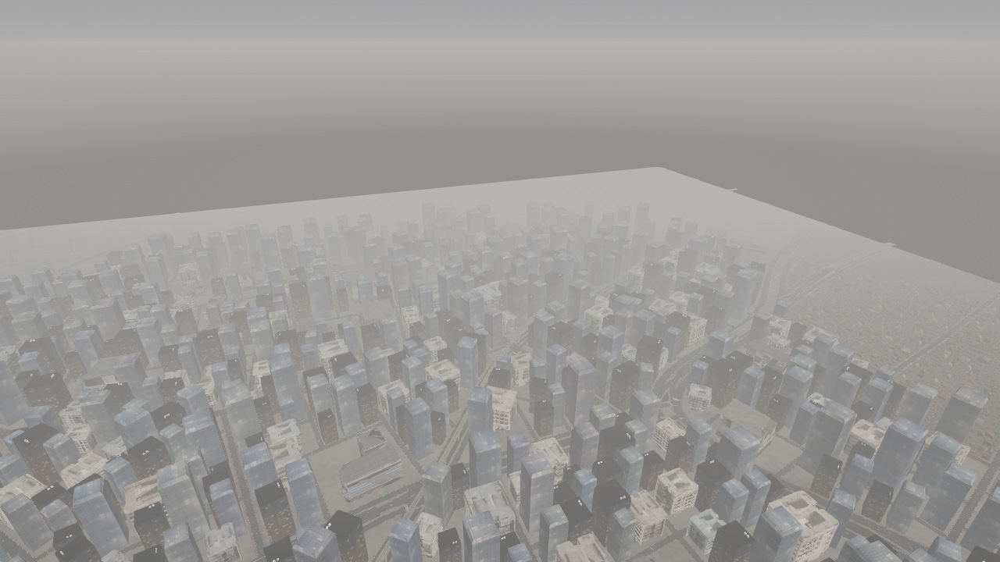
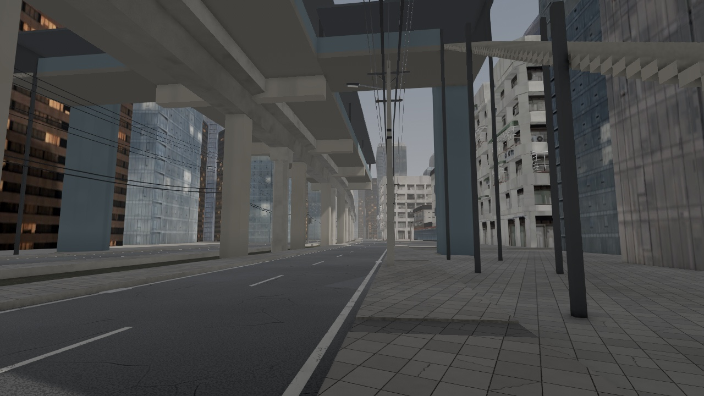
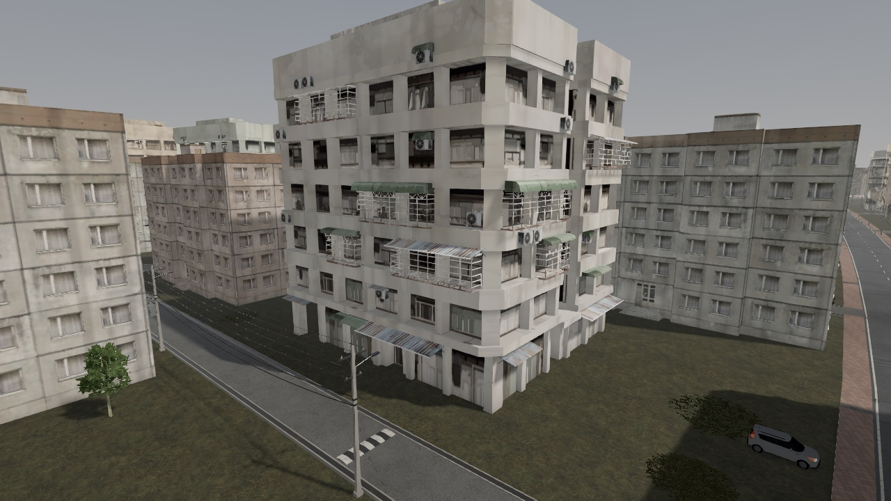
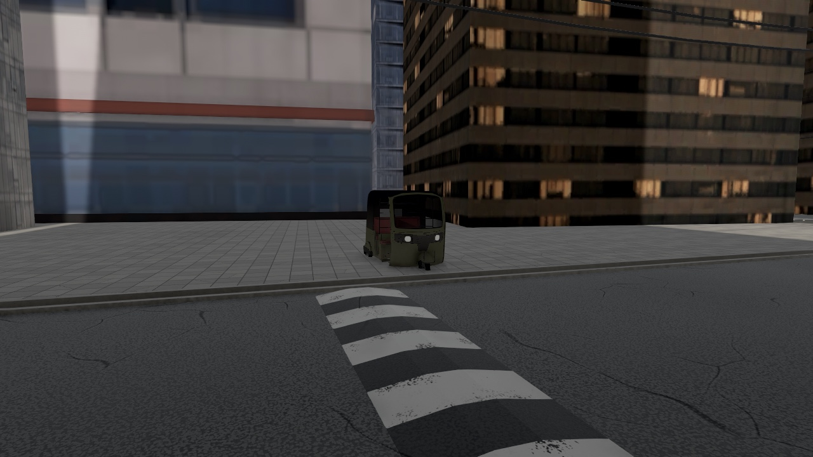
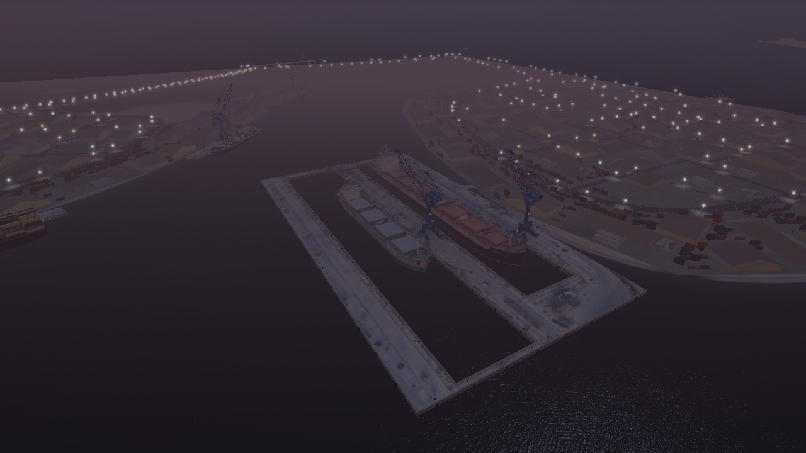
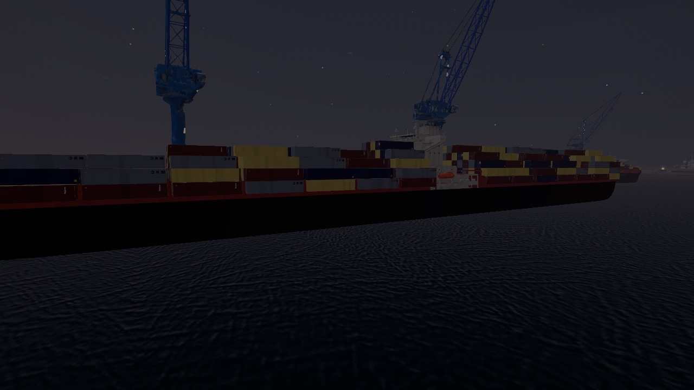

# DHAKA: AFTER DARK

An open-world game set in Dhaka, made in Unity 6.

**Made by Ishak Hasan Sabbir.**

  
  
  
  
  
  

*In-engine shots from the game's own test renders. Work in progress.*

## About

DHAKA: AFTER DARK is a single-player open-world game set in Dhaka, Bangladesh. The streets are laid out from OpenStreetMap data around Farmgate and Karwan Bazar, with the metro viaduct, flyovers, road medians, a railway and a container port.

The target platform is Windows PC. The first playable build runs on macOS (Apple silicon).

## What's in the first playable

- **On foot:** walk, run, crouch and jump. Three guns with aim, fire, reload and a weapon wheel.
- **Vehicles:** get in, drive and get out. City traffic. Board the train.
- **The street:** people on the pavements, gangs who hold their turf, and police with a five-level wanted meter.
- **Jobs:** delivery jobs against the clock, paid in taka, with your cash on the HUD.
- **Who you play:** any of twenty people of the city, ten men and ten women.
- **HUD and menus:**
  - radar, health, armour, wanted level and clock;
  - a city map with waypoints and routes;
  - start screen and pause menu;
  - settings with key rebinding.
- **Saves:** your cash, deliveries and chosen character carry over between runs.
- **Credits:** a Credits screen naming every work the game uses.

[Docs/PRODUCTION/FIRST_PLAYABLE.md](Docs/PRODUCTION/FIRST_PLAYABLE.md) explains how each part is built.

## Status

Work in progress. Still open:
- first- or third-person camera;
- the world beyond the Farmgate area;
- level-of-detail models;
- a Windows build.

## What's in this repository

| Folder | What it holds |
|---|---|
| `Assets/_Project/Runtime` | Game code (C#) |
| `Assets/_Project/Editor` | Editor tools and build steps |
| `Assets/_Project/Shaders` | URP shaders |
| `Assets/_Project/Tests` | EditMode and PlayMode tests |
| `Assets/Trailer` | In-engine trailer code |
| `Tools` | World generation, model baking, benchmarks and trailer editing (Python, Swift, JavaScript, shell) |
| `Docs` | Design document, production log, QA and performance reports |
| `Production/Trailer_2026` | Trailer edit lists, graphics and reports |

## What's not included

Some files are left out so that the licences of the third-party works the game uses are respected:
- people, animations and weapons;
- vehicles, buildings and city models;
- textures and sounds;
- the generated city data.

The code is all here, but the project opens without those files, so it cannot be played from this repository alone. The works are credited in [Docs/ASSET_INVENTORY/CREDITS.md](Docs/ASSET_INVENTORY/CREDITS.md) and on the game's Credits screen.

## Built with

Unity 6000.3.27f1, the Universal Render Pipeline, C#, Python and Swift.

## Credits and licence

- Map data © OpenStreetMap contributors, under the Open Database License (ODbL 1.0).
- Fonts in `Art/Fonts` are under the SIL Open Font License.

© 2026 Ishak Hasan Sabbir. All rights reserved. The source is published to be read; please ask before reusing it.
